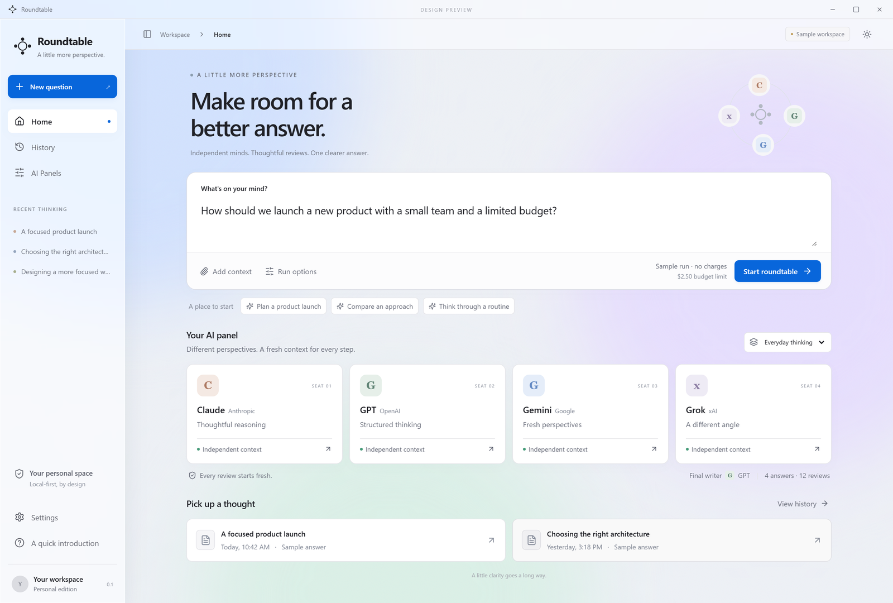
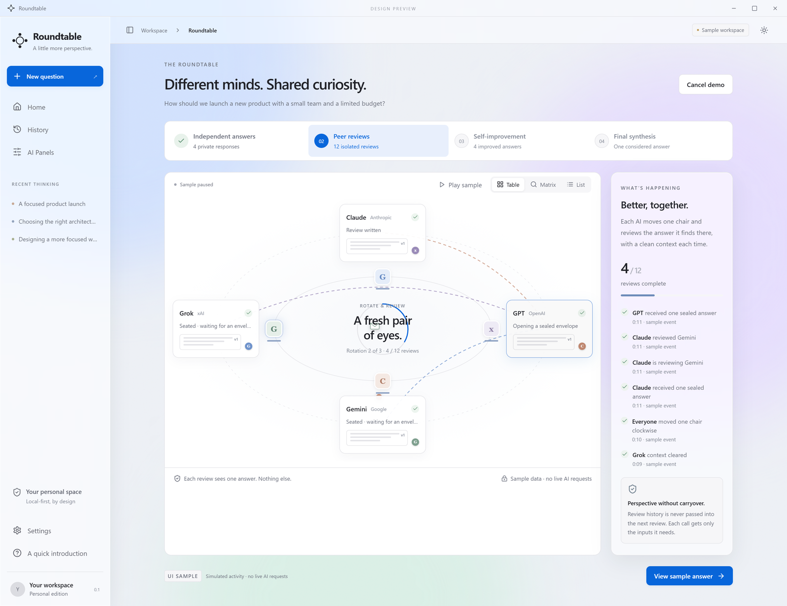
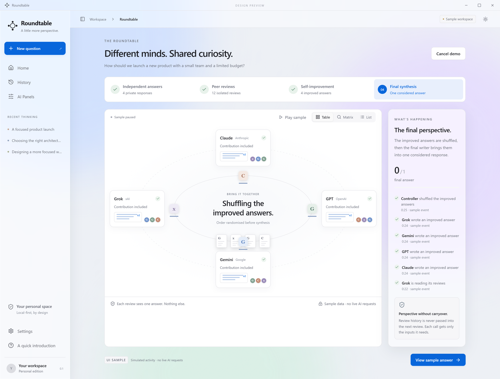

# Roundtable

**A Windows desktop app where several AI models think together.** Ask one question; four LLMs answer on their own, review each other's answers anonymously, revise, and a separate model writes one final answer.



## How a run works

| Stage | What happens |
|---|---|
| 1. Answer | Each model on the panel answers the question independently. |
| 2. Review | Each model reviews the other answers, shown under anonymous aliases in shuffled order, so no model knows whose answer it is reading. |
| 3. Improve | Each model revises its own answer using only the feedback addressed to it. |
| 4. Synthesize | A separate "final writer" model combines the improved answers into one response. |



## Features

- **2 to 8 models per panel.** Works through OpenRouter by default, with adapters for OpenAI, Anthropic, Google, xAI and Groq.
- **Cost control:** a live cost and token display, and a spending cap per run (default $1). A paused run resumes without paying twice for finished calls.
- **Optional web search** per stage, with source URLs recorded.
- **Local-first:** run history is stored in SQLite on your machine, and API keys are kept in Windows Credential Manager, never in plain files.
- **Validated outputs:** every stage's output is checked against a JSON schema before it is saved.
- **Ships as a Windows installer**, so no build tools are needed to use it.

A real 4-model run with web search completed all 21 calls for **$0.19**.



## Architecture

A Tauri 2 desktop shell with a React 19 + TypeScript front end (`ui-prototype/`), over a Rust workspace:

| Crate | Role |
|---|---|
| `rt-core` | Domain types and run/stage state machines |
| `rt-schemas` | JSON-Schema validation for answer, review, improved and final outputs |
| `rt-ledger` | SQLite storage (WAL, migrations, backups) |
| `rt-secrets` | API keys in Windows Credential Manager |
| `rt-envelope` | Controls exactly what context each model sees, including anonymization |
| `rt-budget` | Price catalog, cost reservation and settlement |
| `rt-adapters` | Provider connections (OpenRouter, OpenAI, Anthropic, Google, xAI, Groq) |
| `rt-engine` | Scheduler, retries, commit protocol and progress events |
| `rt-testkit` | Test helpers |

Design documents live in [`docs/`](docs/): the product requirements, backend plan and architecture diagrams.

## Build from source

Requirements: Windows 10/11, Rust (the version is pinned in `rust-toolchain.toml`), Node.js 20+.

```bash
# Rust workspace tests
cargo test --workspace

# Front end
cd ui-prototype
npm install
npm run build

# Desktop app and installer (from apps/desktop)
cd ../apps/desktop
npx tauri build
```

## Tests

About 80 Rust tests cover the state machines, schema checks, anonymization, budgeting and the engine's retry/commit logic. `cargo clippy -- -D warnings` runs clean.

## Author

Built by **Muhammad Maowiz Saleem** — [github.com/maowiz](https://github.com/maowiz)
