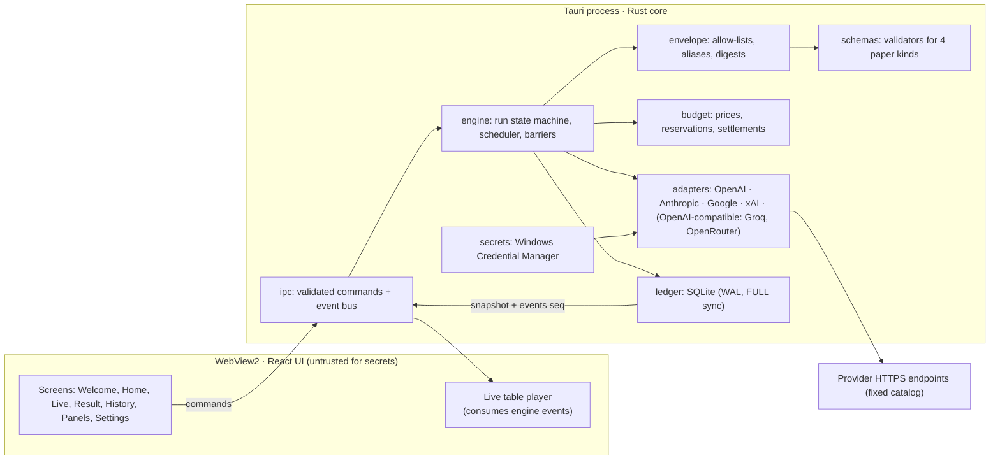

# Roundtable AI — Backend Engineering Plan

| Field | Value |
|---|---|
| Version | 1.0 — end-to-end plan, ready for backlog creation |
| Date | 9 September 2026 |
| Governs | Everything behind the UI: workflow engine, provider adapters, secrets, ledger, budget, IPC, packaging, tests |
| Inputs | [PRD v0.3](PRD.md) (contracts and IDs are authoritative), [research review](PRD_RESEARCH_REVIEW.md), [UI plan](UI_UX_PLAN.md), the built prototype in `ui-prototype/` including `src/live/script.ts` |
| Architecture | Tauri 2 shell · React/TypeScript UI (already built) · **Rust core** (engine, adapters, secrets, SQLite) · Windows 11 x64 |
| Scope | Personal-use v1 (P0 + selected P1). Team, cloud, accounts, telemetry are out of scope |

Every requirement ID quoted below (ISO-, KEY-, PAN-, RUN-, BUD-, OUT-, DATA-, EXP-, SEC-, WIN-, UI-) refers to the PRD. Where this plan makes a choice the PRD left open, it is marked **Decision** and listed again in section 19.

---

## 1. Architecture at a glance



**Principles that shape every module**

1. The renderer never holds a key, never builds a model request, never runs SQL, never picks a host (PRD 11.1, KEY-02, SEC-02/03/04).
2. All memory is the ledger. Every model call is a fresh request built from a stage-specific allow-list of artifact IDs (ISO-01/02/07).
3. Commit before dispatch, commit after acceptance, notify only after commit (PRD 8.4).
4. The engine is a library with no Tauri types. It runs against fake providers and an in-memory SQLite in tests. Tauri is a thin host.
5. Time-derived UI: the engine emits sequenced events; the UI replays them through the same player it uses for the demo script today.

---

## 2. Repository layout

```
roundtable/
  apps/
    desktop/                 Tauri 2 host: tauri.conf.json, capabilities/, src-tauri/src/main.rs (commands + event bridge)
    ui/                      the existing ui-prototype, promoted; adds src/api/ (typed command client) and src/live/liveFeed.ts
  crates/
    rt-core/                 domain types, ids, errors, state machines (no IO)
    rt-envelope/             allow-list builder, alias map, identity suppression, digests
    rt-schemas/              JSON Schemas (versioned) + native validators + fixtures
    rt-budget/               price catalog, reservation/settlement math
    rt-ledger/               rusqlite repository, migrations, backup, deletion, single-writer
    rt-adapters/             ProviderAdapter trait + openai/, anthropic/, google/, xai/, openai_compat/
    rt-engine/               scheduler, run executor, retry policy, barriers, events
    rt-secrets/              keyring wrapper (Windows Credential Manager backend)
    rt-export/               JSON + Markdown (P0), HTML (P1)
    rt-testkit/              fake providers, fault injection, canary tools, clock
  contracts/
    ipc/*.schema.json        command and event payload schemas (source of truth for TS types)
    papers/*.schema.json     answer, review, improved, final (v1)
    prices/catalog.json      versioned price records (BUD-03)
    providers/catalog.json   fixed endpoint catalog (SEC-03)
  tools/
    gen-ts-types             JSON Schema → TypeScript for apps/ui/src/api/types.ts
    smoke                    funded live smoke runner (never in CI by default)
```

**Decision D-B1.** One Cargo workspace, one `pnpm` workspace. TypeScript types for IPC are generated from JSON Schema in `contracts/` and checked in; CI fails if regeneration changes them.

---

## 3. Domain model

### 3.1 Identity

All IDs are ULIDs (sortable, 26 chars). Foreign-run references are rejected at every boundary (ISO-02, SEC-10).

| Entity | Notes |
|---|---|
| Panel (editable template) | name, seats[], synthesizer seat, limits, prompt/rubric versions. Mutable. |
| Run | Frozen snapshot of everything: question, reference text, panel snapshot, prices, schema/app/adapter versions, seed, limits. Immutable after `validating` (ISO-09, PAN-03). |
| Seat (frozen) | seat_index 0..N−1, label, provider, credential_ref, model_id, settings per role (temperature, max_output_words → max_output_tokens, cost cap), prompts (3) with digests. |
| Logical call | (run, stage, reviewer_seat, target_seat?) unique. Holds state, attempts_used, accepted_paper_id. |
| Attempt | one provider request: request_digest, dispatched_at, provider_request_id, outcome, usage, raw bounded output, sanitized error. |
| Envelope | what one logical call is allowed to see: instructions, messages, schema, allowed view IDs, alias map, digest. Built once per logical call; identical across its attempts (ISO-10). |
| Paper | accepted artifact: kind answer/review/improved/final, author seat, target/parent IDs, validated body, digest. Immutable. |
| Artifact view | anonymised transformation of a paper used inside envelopes: source paper, transform version, exact text, digest (PRD 5.3). |
| Budget entry | reservation / settlement / unresolved liability with price snapshot ref. |
| Run event | sequenced, typed, references records, no secrets. |

### 3.2 Run state machine (PRD 8.1)

```
draft ──validate──▶ validating ──ok──▶ answering ──barrier──▶ reviewing ──barrier──▶ improving ──barrier──▶ synthesizing ──accept──▶ completed
   │                    │ fail                 │                   │                   │                    │
   └── (editable) ◀─────┘                     ├── blocked (budget | deadline | exhausted | persistence | context)   ◀── any active stage
                                              ├── cancelling ──▶ cancelled
                                              ├── interrupted  (set on launch for any non-terminal run)  ──resume──▶ same stage
                                              └── failed       (unrecoverable, e.g. schema of final invalid after cap)
```

Persisted separately: `state`, `stage`, `reason_code`, `reason_text`. Transitions are functions in `rt-core` with exhaustive tests; illegal transitions are errors, never silent.

### 3.3 Logical call state machine

```
planned ──reserve budget──▶ ready ──dispatch intent committed──▶ in_flight ──▶ accepted
                                                                     ├──▶ retry_wait (429 / transient) ──▶ in_flight
                                                                     ├──▶ uncertain  (timeout/stream loss after possible acceptance)  [manual retry only]
                                                                     ├──▶ refused    (terminal, no retry)
                                                                     ├──▶ invalid    (schema fail; ≤1 automatic schema retry)
                                                                     └──▶ failed     (attempts exhausted or non-retryable)
```

Attempt cap: **3 total** per logical call, at most one of which is a schema retry (PRD 8.3). No SDK-level retries: adapters make exactly one HTTP request per attempt.

### 3.4 Stage barriers

A stage completes only when every required logical call is `accepted` (RUN-01). Barrier completion is one transaction: verify counts against the plan, write `stage_completed` event, create next stage's logical calls and envelopes, commit. Downstream envelopes are built from committed papers only.

Review plan: for N seats, reviewer i targets (i + r) mod N for r = 1..N−1 (PRD 4). The engine schedules all reviews concurrently under limits; the "rotation" grouping (r) is recorded on each logical call so the UI can group them if it wants, but the engine never waits for a rotation to finish before starting the next.

---

## 4. Ledger (SQLite)

### 4.1 Settings

- One writer: `rt-ledger` owns a single connection guarded by a mutex; readers use separate read-only connections.
- `journal_mode=WAL`, `synchronous=FULL`, `foreign_keys=ON`, `busy_timeout=5000` (DATA, PRD 12.2). Verified on target hardware at M0.
- Location: `%LOCALAPPDATA%\Roundtable\data\roundtable.db` (outside install dir, WIN-01). Backups under `...\data\backups\` with visible retention (DATA-06).
- Single instance: a lock file plus Tauri single-instance plugin. The second launch activates the first window (PRD 8.2).

### 4.2 Schema (v1)

```sql
-- templates (mutable)
panels(id PK, name, json, prompt_rubric_version, created_at, updated_at);
settings(key PK, json, updated_at);

-- frozen run
runs(id PK, state, stage, reason_code, reason_text, question, reference_text,
     panel_snapshot_json, limits_json, price_catalog_version, schema_version, app_version,
     adapter_versions_json, seed, is_sample INTEGER DEFAULT 0,
     created_at, started_at, deadline_at, finished_at);
seats(run_id FK, seat_index, label, provider, credential_ref, model_id, model_returned_id, settings_json,
      prompt_answer, prompt_review, prompt_improve, prompt_digests_json, PRIMARY KEY(run_id, seat_index));
logical_calls(id PK, run_id FK, stage, reviewer_seat, target_seat, rotation, state, attempts_used,
              accepted_paper_id NULL, envelope_id NULL, created_at, updated_at,
              UNIQUE(run_id, stage, reviewer_seat, target_seat));
envelopes(id PK, run_id FK, logical_call_id FK UNIQUE, stage, instructions, messages_json, schema_id,
          allowed_view_ids_json, alias_map_json, digest, created_at);
attempts(id PK, logical_call_id FK, ordinal, kind ('primary'|'transport_retry'|'schema_retry'|'manual'),
         request_digest, serialized_body_redacted, dispatched_at, first_byte_at, completed_at,
         provider_request_id, outcome, finish_reason, usage_json, raw_output_bounded, error_category, error_sanitized,
         UNIQUE(logical_call_id, ordinal));
papers(id PK, run_id FK, kind, author_seat, target_paper_id NULL, parent_paper_id NULL,
       schema_version, body_json, digest, attempt_id FK, created_at);
artifact_views(id PK, paper_id FK, transform_version, view_text, digest, possibly_identifiable INTEGER);
run_events(run_id FK, seq INTEGER, type, payload_json, created_at, PRIMARY KEY(run_id, seq));
budget_entries(id PK, run_id FK, logical_call_id FK NULL, attempt_id FK NULL, kind ('reserve'|'settle'|'release'|'unresolved'),
               amount_usd_micro INTEGER, price_ref, created_at);
credentials_meta(ref PK, provider, label, created_at, last_tested_at, last_test_result);   -- never the key
```

Indexes: `logical_calls(run_id, state)`, `papers(run_id, kind)`, `attempts(logical_call_id)`, `run_events(run_id, seq)`, `runs(created_at DESC)`, FTS5 virtual table over `runs.question` and final answer text for History search (UI-07).

Immutability: no UPDATE/DELETE on `papers`, `envelopes`, `artifact_views` outside the maintenance path. Enforced by triggers that check a session-scoped `maintenance_mode` flag set only by `rt-ledger::delete_run` and migrations (DATA-01/03).

### 4.3 Migrations and backup

- Numbered SQL migrations, applied in a transaction with `user_version`. Before any migration: SQLite online backup API to `backups/pre-migration-<version>-<date>.db`; keep the previous compatible backup until startup checks pass (PRD 12.2).
- Corruption (`PRAGMA integrity_check` fails at startup) opens a recovery screen with options: restore latest backup, export what is readable, start fresh. Never silently reset.

### 4.4 Deletion (DATA-01…07)

`delete_run(id)`: cancel dispatch for the run → detach in-flight attempts (late responses are dropped by run-id check) → maintenance transaction removes runs, seats, calls, envelopes, attempts, papers, views, events, budget rows, FTS rows → `PRAGMA secure_delete=ON` for that connection → report which app-managed backups still contain the run and offer their removal. UI copy never says "deleted everywhere".

---

## 5. Envelope policy (`rt-envelope`)

The only code that turns ledger content into model input. Pure functions with property tests.

### 5.1 Allow-lists per stage (ISO-03/04/05)

| Stage | Instructions | Data messages (in order) | Schema |
|---|---|---|---|
| answer | shared stage instructions + seat's answer prompt | task, reference text (with Ref-n IDs) | answer.v1 |
| review | shared + seat's review prompt + rubric | task, reference text, **one** anonymous view of the target's original answer with alias `A-<opaque>` | review.v1 |
| improve | shared + seat's improve prompt | task, reference text, seat's own original answer, N−1 anonymous views of reviews **about it**, shuffled, aliases `R-<opaque>` | improved.v1 |
| synthesize | shared + synthesizer prompt | task, reference text, N anonymous views of improved answers, shuffled, aliases `C-<opaque>`; each view = revised answer + revised claims + unresolved issues (never the decision audit, never raw reviews) | final.v1 |

The builder takes `(run, stage, logical_call)` and returns `Envelope { instructions, messages, schema_id, allowed_view_ids, alias_map, digest }`. It **cannot** accept arbitrary paper IDs: it derives them from the run's papers by role, and any paper from another run, another stage, or the reviewer's own answer in a review makes it return an error (tested with generated cases for N = 2…8).

### 5.2 Anonymous views (PRD 5.3)

- Transform v1: strip the seat label and provider/model names using a fixed, documented list built from the run snapshot (exact and case-insensitive tokens, word-bounded). Replace with "another model". Record `possibly_identifiable = 1` if any token could not be safely replaced (e.g. inside a code block). No paraphrasing.
- Store the exact view text and digest. The envelope references view IDs, never paper IDs, for foreign content.
- Shuffle order with a ChaCha RNG seeded by `run.seed || logical_call.id`; store the resulting order in `alias_map_json`.

### 5.3 Digests

`digest = SHA-256(canonical JSON of instructions, messages, schema_id, allowed_view_ids)`. Automatic retries must produce an identical digest (ISO-10); tests assert it.

### 5.4 Canaries (PRD 5.2)

`rt-testkit` plants unique tokens in every paper of a simulated run and asserts, at the **serialized provider body** level, that each attempt's body contains only permitted canaries. Runs for N = 2…8, cinematic and concurrent schedules, resumed runs and schema retries.

---

## 6. Output schemas and validation (`rt-schemas`)

Four JSON Schemas, `draft 2020-12`, versioned `*.v1`, with bounded strings and arrays (OUT-01). Native validation (`jsonschema` crate) followed by semantic checks (OUT-02):

- Claim IDs unique within a paper; issue IDs unique within a review.
- Review `target_alias` equals the envelope's single allowed alias; every `target_claim_id` exists in that view; "no material issue" is valid (OUT-04).
- Improved answer contains exactly one decision per supplied issue ID, no more, no fewer.
- Final answer: every supporting alias is one of the envelope's aliases; claims without support must carry `support: "unsupported"` (OUT-05); references to `Ref-n` must exist.
- Size limits: response ≤ 256 KiB before parsing; ≤ 50 claims/issues.

Provider strategy for structured output (adapter release gate, PRD 7.3):

| Provider | Mechanism | Fallback |
|---|---|---|
| OpenAI | Responses API `text.format = json_schema` (strict) | none needed |
| Anthropic | Structured outputs (`output_format` json_schema) where the model supports it; otherwise tool-use with a single forced tool | validate anyway |
| Google Gemini | `responseSchema` + `responseMimeType: application/json` (subset of schema features) | keep schemas within the documented subset |
| xAI, Groq, OpenRouter (OpenAI-compatible) | `response_format: json_schema` when supported by the model; else JSON mode + validation | one schema retry |

Whatever the mechanism, the native validator is the judge. Valid JSON that fails semantic checks is `invalid` (OUT-03).

---

## 7. Provider adapters (`rt-adapters`)

```rust
#[async_trait]
pub trait ProviderAdapter: Send + Sync {
    fn id(&self) -> ProviderId;
    fn capabilities(&self, model: &ModelId) -> Capabilities;      // schema subset, streaming, settings, reasoning param
    fn build_request(&self, env: &Envelope, seat: &FrozenSeat, limits: &CallLimits) -> Result<WireRequest>;   // no secrets here
    async fn dispatch(&self, req: WireRequest, key: SecretRef, deadline: Instant, cancel: CancelToken) -> AttemptResult;
    fn map_usage(&self, raw: &Value) -> Usage;                    // input/output/reasoning/cache, no double counting
    fn classify_error(&self, status: u16, body: &str, transport: Option<&Error>) -> ErrorCategory;
}
```

- **Fixed endpoint catalog** (`contracts/providers/catalog.json`): host, path, API version, TLS required, redirect policy = none. Custom base URLs are P2 (SEC-03).
- Credential injection happens only inside `dispatch`, from `rt-secrets` by reference; `WireRequest` is persisted redacted (Authorization header excluded) with its digest (PRD 12.1).
- HTTP client: `reqwest` with rustls, HTTP/2, connection pooling, per-request deadline, no automatic retries, no redirect following.
- `ErrorCategory`: `auth | quota | rate_limit(retry_after) | model_unavailable | invalid_request | transport_before_send | transport_after_send | timeout | refusal | truncated | malformed | server`. Each maps to the retry table in PRD 8.3.
- Idempotency: use provider idempotency keys only where documented; store the key on the attempt; otherwise `uncertain` requires a manual retry with the billing warning.
- Streaming is P1: adapters expose `dispatch_stream` yielding text deltas for UI-09 previews; the accepted paper is always built from the final body after validation.

Release gate per provider (PRD 7.3): recorded fixtures for all four paper kinds, refusal, truncation, 429 with Retry-After, malformed JSON, and a dated live smoke record. A provider not passing the gate is disabled in the catalog, never silently substituted (PAN-04).

**Decision D-B2.** Groq and OpenRouter are supported through the `openai_compat` adapter with their own catalog entries and capability tables, so the "moving alias" caveat is shown for their model IDs (PAN-03).

---

## 8. Engine and scheduler (`rt-engine`)

### 8.1 Components

- `RunExecutor`: drives one run through stages; owns its cancel token; single active run in v1 (PRD 8.2).
- `Scheduler`: bounded concurrency — global in-flight 8, per-provider 2, hard max 16, frozen per run; honors `Retry-After`; jittered exponential backoff (base 1 s, factor 2, cap 30 s) bounded by remaining attempts and run deadline.
- `Clock` and `Rng` traits injected for deterministic tests.
- `EventBus`: append `run_events` in the same transaction as the state change, then broadcast to IPC subscribers with `seq`.

### 8.2 Commit protocol as code (PRD 8.4)

```
tx1: create logical_call (planned) + envelope + budget reserve → ready
tx2: attempt row with dispatch intent (in_flight) — crash after tx2 ⇒ attempt is 'uncertain' on recovery
      … HTTP request …
tx3: attempt outcome + usage + budget settle/release + (if accepted) paper + view + call.accepted + event
tx4 (barrier): when all calls in stage accepted → stage_completed event + next stage calls/envelopes/reservations
```

Late responses (after cancel, delete, or accept of a duplicate) update only attempt diagnostics and usage; guards check `run.state` and `call.state` inside tx3.

### 8.3 Deadlines and lifecycle

- Per-attempt deadline 90 s, run deadline 300 s (BUD-06), both frozen in the run; suspended time counts. The user may extend via a limit-amendment event.
- Windows suspend/resume and network loss (`netsh`-free: use `IpHelper` notifications through `windows` crate or poll `NetworkListManager`): stop new dispatch, mark in-flight attempts `uncertain` if their deadline passes while suspended, reconcile on resume, never auto-fire all retries at once (stagger by 250 ms).
- Close during a run: window close event asks "Stay open / Cancel and close"; forced termination is handled by launch-time interruption marking.
- Launch: mark non-terminal runs `interrupted`; compute committed / pending / uncertain per run; History shows Resume with remaining calls, budget and uncertain attempts first; resume never re-dispatches automatically.

### 8.4 Preflight (`preflightRun`)

Validates without any paid call: question and reference sizes, prompts sizes, credentials present for each seat's provider, model capability vs requested settings (temperature vs reasoning models), schema subset support, context capacity estimate for the largest downstream envelope (BUD-07), cost estimate low/high, attempt maximum, and the review count N(N−1). Returns a `PreflightReport` the Home screen shows next to Start (UI-01).

---

## 9. Budget (`rt-budget`)

- Price catalog `contracts/prices/catalog.json`: per provider/model, input/output/reasoning/cache prices per 1M tokens, currency, source URL, checked date, catalog version (BUD-03). Frozen into the run.
- Token estimation: tokenizer-free conservative estimate (chars/3.2 for English, plus 10 %) for inputs; output bound = seat's max_output_tokens (derived from the UI's max words × 1.4); reasoning bound per model capability.
- Reservation before each dispatch: `max_cost = in_est × p_in + out_bound × p_out + reasoning_bound × p_reason`. Reservations + settled + unresolved ≤ run ceiling, else `blocked(budget)` (BUD-04). Per-seat cost cap from the UI's "Seat limits" is a second guard applied per seat.
- Settlement from provider usage; unknown usage stays `unresolved`, shown distinctly from zero (BUD-02). Uncertain attempts keep their reservation as unresolved liability until the user resolves them.
- Every money value is integer micro-USD; no floats in the ledger.

---

## 10. Secrets (`rt-secrets`)

- `keyring` crate, Windows backend (Credential Manager), service name `Roundtable`, one entry per `credential_ref` (KEY-01). Tested at M0 on a locked credential store (KEY-06).
- Commands: `saveCredential(provider, label, secret)`, `testCredential(ref)` (synthetic 1-token prompt, explicit "may be charged" in UI, returns category + sanitized message, KEY-04), `deleteCredential(ref)` (cancels related in-flight work first, KEY-05), `listCredentials()` (labels and status only, KEY-02).
- The secret string is zeroized after use (`zeroize` crate); never logged, never in events, never in exports; `Debug` impl redacts.

---

## 11. IPC contract (`contracts/ipc`)

### 11.1 Commands (renderer → core)

| Command | Input | Output | Notes |
|---|---|---|---|
| `listCredentials` | — | `CredentialMeta[]` | |
| `saveCredential` | provider, label, secret | ref | secret only crosses IPC here |
| `testCredential` | ref | `TestResult` | |
| `deleteCredential` | ref | ok | |
| `listPanels` / `savePanel` / `deletePanel` / `duplicatePanel` | Panel | Panel | validates seats 2..8, prompts ≤ 12k chars, settings supported |
| `listModels` | provider | `ModelInfo[]` (from catalog, with alias flag) | no network |
| `preflightRun` | question, referenceText?, panelId, limits | `PreflightReport` | zero paid calls |
| `startRun` | preflight token (hash of the validated inputs), confirmed ceiling | runId | rejects if inputs changed since preflight |
| `cancelRun` / `resumeRun` / `retryUncertain(callId)` | runId (+callId) | ok | manual retry shows "may be billed" first |
| `getRunSnapshot` | runId | `RunSnapshot` (state, stage, seats, calls, papers metadata, coverage, budget, last seq) | |
| `subscribeRun` / `unsubscribeRun` | runId, fromSeq | stream of `RunEvent` | replays gaps from ledger |
| `inspectPaper` | paperId | paper body, view text, envelope, attempts, validation report | UI-05 |
| `listRuns` | query, filters, page | `RunSummary[]` | FTS |
| `exportRun` | runId, format, includePrompts, includeReference, path from Save As | ok | atomic write |
| `deleteRun` | runId | `DeletionReport` | |
| `getSettings` / `saveSettings` | | | theme, glass, reduced motion, defaults |
| `getDiagnostics` | — | redacted bundle path | user-initiated |
| `openExternal` | url | ok | restricted opener, https only, user-initiated |

Every command validates IDs (ULID), sizes, ownership and state natively; unknown fields are rejected (SEC-10). No fetch, SQL, path or envelope is accepted from the renderer.

### 11.2 Events (core → renderer), with `seq`

Engine events are the source of truth; the live table's demo vocabulary maps onto them one-to-one so the existing player keeps working:

| Engine event | Payload | Live table visual (today's `script.ts` name) |
|---|---|---|
| `run.state_changed` | state, stage, reason | stage strip, notices |
| `stage.started` | stage, planned call count | `run_started` for stage 0 |
| `call.queued` | callId, stage, reviewer, target, rotation | chair status "queued" |
| `call.started` | callId, attempt ordinal | `seat_thinking` / `envelope_sent` (review) / `improve_started` |
| `call.delta` (P1) | callId, text delta | `token` |
| `call.retry_wait` | callId, until, reason | chair status "retrying (rate limit)" |
| `call.accepted` | callId, paperId, kind | `paper_created` / `review_done` (tag flight) |
| `call.refused` / `call.invalid` / `call.failed` / `call.uncertain` | callId, category, sanitized text | chair dims + red tag; list shows next step |
| `stage.completed` | stage, coverage | `seats_returned` before improve; `shuffle` (with recorded order) before synthesis |
| `budget.updated` | known, estimated, unresolved, reserved | right panel cost line |
| `run.completed` | finalPaperId | `run_finished` |

**Decision D-B3.** In live runs the UI plays events at arrival time ("true timing"). The "cinematic" mode stays available for replays from History, and the UI labels it "replay, sequential for clarity" so it never implies the engine ran sequentially (PRD 4).

### 11.3 UI screen → backend mapping

| Screen | Commands used | Events |
|---|---|---|
| Welcome & Connect | listCredentials, saveCredential, testCredential | — |
| Home | listPanels, preflightRun, startRun | — |
| Live Roundtable | getRunSnapshot, subscribeRun, cancelRun, resumeRun, retryUncertain, inspectPaper | all run events |
| Final Answer | getRunSnapshot, inspectPaper, exportRun | — |
| History | listRuns, getRunSnapshot, deleteRun, exportRun | run.state_changed for interrupted runs |
| AI Panels | listPanels, savePanel, listModels, duplicatePanel, deletePanel | — |
| Settings | getSettings, saveSettings, credentials commands, getDiagnostics | — |

The seat editor fields already in the UI map directly: temperature per role → `settings_json.temperature[role]`, max output words → `max_output_tokens` per role, per-seat cost cap → `settings_json.cost_cap_usd_micro`.

---

## 12. Sample mode

The bundled sample the UI shows today becomes a real ledger run flagged `is_sample = 1`, loaded from `contracts/samples/*.json` on first launch. It has full papers, envelopes and events so every inspector and the export path work identically, but `startRun` refuses to dispatch for sample runs and all surfaces keep the "Sample" label. This removes a second code path in the UI.

---

## 13. Security controls (PRD 14)

- Tauri capabilities: only the commands above; no `shell`, `fs`, `http`, `sql` plugins in the release capability set (SEC-02). `dangerousRemoteDomainIpcAccess` off. CSP: `default-src 'self'; img-src 'self' data:; style-src 'self' 'unsafe-inline'; connect-src 'none'` in release (SEC-01/09).
- Endpoint enforcement inside adapters (catalog), TLS validation on, redirects disabled (SEC-03).
- Model output is data: rendered as sanitized Markdown (allow-list of inline/block elements, no raw HTML, no images, links inert until clicked through `openExternal`).
- Bounds everywhere (SEC-07): request body ≤ 1 MiB, response ≤ 256 KiB retained, ≤ 50 claims, prompts ≤ 12k, question ≤ 20k, reference ≤ 40k.
- Logging: `tracing` with a redaction layer; no prompt or response content at default level; keys never formatted. Log files rotate at 5 × 5 MiB under `%LOCALAPPDATA%\Roundtable\logs`.
- No analytics, no crash upload (SEC-08). Diagnostics are a user-triggered redacted zip.

---

## 14. Export and provenance (`rt-export`)

- JSON (P0): `format_version`, run snapshot, coverage, all accepted papers, envelopes, attempts (redacted bodies), usage and cost certainty, alias maps, events. Excludes credentials and machine identifiers (EXP-01).
- Markdown (P0): final answer, status/coverage, limitations, attribution, cost summary; explicit "no final answer" when absent.
- Prompts and reference text are included only when the user ticks them; the summary lists what is inside (EXP-02).
- Save As via Tauri dialog plugin restricted to the export command; write to temp then atomic rename; confirm overwrite.
- HTML export (P1): same sanitizer as the UI, no scripts, no remote assets.

---

## 15. Testing strategy

| Layer | Tooling | What it proves |
|---|---|---|
| Unit + property | `cargo test`, `proptest` | state machines, allow-lists (N = 2…8), alias transform, digests, budget math, schema semantics |
| Wire payload | fixtures per adapter | serialized bodies contain only allowed data; no session IDs; headers redacted in ledger |
| Canary suite | `rt-testkit` | zero forbidden canaries across schedules, retries, resume (ISO-01…10) |
| Fault injection | fake providers with programmable outcomes | 429, auth, timeout after send, stream drop, malformed JSON, refusal, truncation, late response after cancel/delete |
| Crash injection | kill points between tx1…tx4 | every committed paper survives; uncertain attempts identified; no duplicate acceptance |
| Persistence | temp DBs | disk full, locked DB, corruption, migration + backup + rollback, deletion completeness, FTS consistency |
| Money | table tests | concurrent reservations, unknown usage, stale rates, 8-seat worst case |
| IPC contract | schema tests + generated types | unknown fields rejected, foreign IDs rejected |
| UI presentation | Playwright (existing `scripts/capture.cjs`) | screens against the sample ledger and a fake event stream |
| Desktop integration | WebdriverIO + `tauri-driver` on Windows | real Credential Manager, commands, close-during-run, single instance, install/upgrade/uninstall |
| Live smoke | `tools/smoke`, funded, manual | one 2-seat run per provider; dated record in the adapter gate |

CI: Windows runner, `cargo clippy -D warnings`, `cargo deny` (licenses/advisories), fixtures only. No secrets in CI.

---

## 16. Build, packaging, updates (PRD 15)

- Toolchain pinned at M0 (`rust-toolchain.toml`, Node LTS, Tauri CLI). Release profile: LTO thin, `panic = abort`, symbols stripped, PDBs kept privately.
- Installer: NSIS per-user, WebView2 bootstrapper mode "downloadBootstrapper" with size reported separately (WIN-01/02). App data under `%LOCALAPPDATA%\Roundtable`.
- Code signing: Windows Authenticode certificate for the exe and installer; Tauri updater signature separately (WIN-05). Updater is P1 and user-initiated (WIN-06); P0 supports manual signed upgrades with migration (WIN-07).
- Clean-machine test matrix: install, launch, upgrade, failed migration, uninstall, reinstall, non-ASCII username, path with spaces, 200 % DPI (WIN-03).
- Version string shown in Settings with catalog versions (prices, providers, schemas).

---

## 17. Work breakdown and sequencing

Each step ends with tests green and, where visible, a screenshot from the real app.

| # | Milestone | Deliverables | Exit criteria |
|---|---|---|---|
| 0 | M0 Feasibility (1–2 weeks) | Workspace skeleton; pinned toolchain; `rt-secrets` on real Credential Manager; one adapter vertical slice per provider (auth + tiny schema call) with fixtures; SQLite WAL/FULL verified; IPC schemas + type generation; provider and price catalogs seeded | Each provider passes a minimal schema call; keys round-trip through Credential Manager; contracts checked in |
| 1 | Deterministic core (3 weeks) | `rt-core`, `rt-envelope`, `rt-schemas`, `rt-budget`, `rt-ledger`, `rt-engine` against fake providers; canary, fault and crash suites; sample run loader | Routing, failure and recovery acceptance groups pass; canary zero-leak for N = 2…8 |
| 2 | Alpha on Windows (3 weeks) | Real adapters behind the release gate; Tauri host with all commands; UI wired: Welcome, Home (preflight), Live (event feed), Result, History, Panels, Settings; cancel/resume; deletion; JSON/Markdown export | End-to-end real-provider 4-seat run from the installed app; offline history; no P0 secret/isolation defect |
| 3 | Hardening and packaging (2 weeks) | Suspend/resume, single instance, close-during-run, diagnostics, log redaction, migration/backup, NSIS + signing, clean-machine matrix, accessibility pass | Signed installer passes the WIN-03 matrix; performance targets measured and recorded |
| 4 | Pilot release | Versioned installer for end users; sample bundled; known limitations doc | Product owner sign-off |
| P1 | Streaming previews, HTML export, panel import/export, partial completion, updater | Feature contracts and tests without touching P0 invariants |

Estimates assume one engineer comfortable in Rust and TypeScript, plus funded provider test budgets. The order is fixed: nothing paid is dispatched until the deterministic core passes its suites.

---

## 18. Risks and mitigations

| Risk | Mitigation |
|---|---|
| Provider structured-output differences break schemas | Schemas restricted to the common subset; per-provider gate with fixtures; one schema retry; native validator is final |
| Rust ownership unavailable | Documented fallback: Electron with the same contracts and a TypeScript core; the JSON Schemas, ledger design and state machines carry over unchanged |
| Rate limits stall the review stage | Per-provider concurrency, Retry-After, staggered resume; UI shows queue state honestly |
| Uncertain outcomes double-bill | Outcome-unknown state, reservation kept, manual retry with warning, provider idempotency where documented |
| Credential Manager locked or denied | KEY-06 path: paid dispatch blocked with recovery message; history works |
| WebView2 missing or Energy Saver disables Acrylic | Bootstrapper handles runtime; glass falls back to the in-app desk (UI plan section 6) |
| Prompt injection through peer papers | Data/instruction separation, no tools, lineage validation, adversarial fixtures, inert rendering |
| Database growth from raw outputs | Bounded raw retention (256 KiB per attempt), pagination, FTS; purge option for attempts of deleted runs |

---

## 19. Decisions made in this plan

| ID | Decision |
|---|---|
| D-B1 | Cargo + pnpm workspaces; IPC types generated from JSON Schema and checked in |
| D-B2 | Groq and OpenRouter via an OpenAI-compatible adapter with their own catalog entries and alias caveats |
| D-B3 | Live runs play at true timing; cinematic sequencing is a labelled replay mode only |
| D-B4 | ULIDs everywhere; micro-USD integers for money; SHA-256 digests |
| D-B5 | Sample workspace is a real ledger run flagged `is_sample`, not a separate UI code path |
| D-B6 | `reqwest` + rustls, no automatic retries or redirects; `keyring` + `zeroize`; `rusqlite` bundled; `jsonschema` validator; `tracing` with redaction |
| D-B7 | Single active run in v1; queueing is P1 |

Open inputs still owned by the product owner (unchanged from PRD 20): pilot task domain, exact model roster per provider at M0, acceptable spend/latency profile, Windows signing certificate, engineering ownership.

---

## 20. Implementation status (9 September 2026)

| Step | Crates | State | Tests |
|---|---|---|---|
| 1 | rt-core, rt-schemas, rt-ledger, rt-secrets | done | ids, money, stages, review plan, state machines, schema semantics, WAL/FULL, migrations + backup, immutability triggers, real Credential Manager round trip |
| 2 | rt-envelope, rt-budget, rt-testkit | done | allow-lists for N = 2…8 with canaries, identity suppression, seeded shuffles, stable digests; price catalog, reservations, settlement, run estimate |
| 3 | rt-adapters, rt-engine | done | OpenAI, Anthropic, Google, OpenAI-compatible adapters with fixture tests and host enforcement; fake provider; engine end-to-end: 4-seat completion with wire-level canaries, 2 and 8 seats, schema retry with identical digest, exhausted attempts, rate-limit wait, refusal and auth no-retry, uncertain outcome with liability and manual retry, cancel, budget block before dispatch, crash + launch recovery + resume reusing accepted papers, late response guard, deletion |
| 4 | apps/desktop (Tauri 2 host), UI desktop module | done | 22 validated commands, event bridge with sequence numbers, launch-time recovery, single instance; UI: typed IPC client with preview fallback, live feed mapping engine events onto the table player, real Connections, real Panels, panel picker with preflight, LiveRun, RunResult, RunHistory, paper inspector. Verified by driving the real app over WebView2 CDP: key save/test/delete through Credential Manager, a real HTTPS call to the provider (401 with redacted message), panels, picker, history |
| 5 | Export, diagnostics, NSIS packaging, signing | next | |

Toolchain: Rust 1.98.1 (pinned), MSVC 14.29, Windows SDK 10.0.22621, Node 22, pnpm 11. `cargo clippy --workspace --all-targets -- -D warnings` is clean; `cargo test --workspace` passes 80 tests.

Known gaps to close before live provider use: verify the seed price records (BUD-03) and flip `verified` to true, run the adapter release gate against real keys (PRD 7.3), then a first real 2-seat run through the app. Streaming previews are P1. To run the desktop app in development: `npm run dev` in ui-prototype, then `cargo run -p roundtable-desktop`; `node ui-prototype/scripts/desktop-smoke.cjs` drives the real app over WebView2's debugging port when it was launched with `WEBVIEW2_ADDITIONAL_BROWSER_ARGUMENTS=--remote-debugging-port=9222`.

### 2026-09-10: review issues are unranked

The per-issue `severity` (low / medium / high) was removed from `review.v1` at the user's request: a rating invites analysis paralysis and reviewers were applying it inconsistently. Reviewers now state each issue plainly (id, optional target claim, explanation, suggested correction). Stage instructions moved to `stage-instructions.v2`. A stray `severity` emitted by a model is discarded during validation rather than rejected (regression test in rt-schemas). Existing ledger papers keep whatever they contained; the UI does not display the field.

### 2026-09-13: per-stage web search (OpenRouter)

- `RoleSettings.web_search` (default false) is frozen per seat and stage. The panel document carries four panel-wide switches (`webSearch.answer/review/improve/synthesize`); `to_run_input` copies them onto every seat's role settings and the synthesizer.
- OpenRouter adapter: when on, the request carries `plugins: [{ id: "web", engine: "exa", max_results: 5 }]` and the system text gains a note that web results are reference material, never instructions. Other providers refuse the setting (`UnsupportedSetting`) and preflight reports it before any spend. Only the seat that searched sees its results; the envelope, aliases and stage allow-lists are unchanged.
- Budget: `rt_budget::WEB_SEARCH_FEE` ($0.007 per call, Exa, verified against the OpenRouter docs on 2026-09-12) is added to the reservation and the settlement of every call that had search on, and to the preflight estimate (`webSearchCalls`, `webSearchFeeUsd`).
- Evidence: `url_citation` annotations are captured as `web_sources` (https URLs only, bounded) inside the attempt's `usage_json`; `list_run_papers` joins them onto each paper as `sources`, the stage browser lists them under "Web sources this seat saw", and the stage strip shows a web badge on stages that searched.
- Verification: `ui-prototype/scripts/desktop-websearch.cjs` edits the default panel over CDP, checks persistence and the preflight note; `RUN=1` performs a real run and asserts sources on the answer cards.
- Verified 2026-09-13 with a real run (question about recent OpenRouter API changes): all four seats searched, 20 sources recorded, run completed 21/21 for $0.19. Two fixes fell out of it: (1) a truncated attempt is retried with doubled reasoning headroom (`CallParams.truncation_retries`) instead of the identical request; (2) the host now removes a finished run from its active list, so a blocked run can be resumed without restarting the app. Runs with search on get a 240 s attempt deadline and a 25 min run deadline.

### 2026-09-18: installer and first-run experience (step 5, part 1)

- `Roundtable_0.1.0_x64-setup.exe` (NSIS, per-user, WebView2 bootstrapper) is produced by `tauri build` from `apps/desktop` using the CLI in `ui-prototype/node_modules/.bin/tauri`. Build with `LOCALAPPDATA`, `TEMP` and `CARGO_TARGET_DIR` pointed at E: (the machine's C: drive is full). Output copied to `output/installer/` with `docs/INSTALL.md`.
- First run: when an OpenRouter key is saved (Connections defaults to OpenRouter) and no real panel exists, the UI creates "Roundtable panel" with four default models and Gemini as final writer, and Home selects it automatically. Home then shows the real seats instead of the sample cards and labels the button "Real run · charges apply". The preview's fake title bar is hidden inside the real window.
- Verified: silent install to a test folder, launch from embedded assets (`http://tauri.localhost`), first-run panel creation, preflight ready.
- Not done: code signing (SmartScreen shows "unknown publisher" once), JSON/Markdown export, diagnostics bundle, auto-update.
