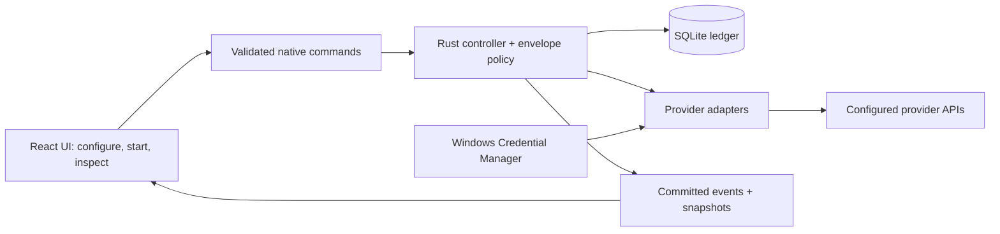

# Roundtable AI — Windows Desktop Product Requirements

| Field | Value |
|---|---|
| Version | 0.3 — personal-use and design-first amendment |
| Date | 8 September 2026 |
| Status | UI planning; individual screens and connected flow require approval before application development |
| Platform | Windows only; v1 target: Windows 11 x64 |
| Product | A personal desktop app for independent multi-model answers, isolated peer review and traceable synthesis |
| Recommended architecture | Tauri 2, React + TypeScript, Rust workflow core, SQLite, Windows Credential Manager |
| Scope owner | Product owner; implementation estimates and exact dependency versions are set at M0 |
| Replaces | PRD v0.1; preserved in [archive/PRD-v0.1.md](archive/PRD-v0.1.md) |
| Review companion | [Research findings and change rationale](PRD_RESEARCH_REVIEW.md) |
| UI plan | [Seven screens, navigation, visual direction and design order](UI_UX_PLAN.md) |
| Backend plan | [End-to-end engineering plan: crates, ledger schema, envelope policy, adapters, scheduler, IPC, tests, milestones](BACKEND_PLAN.md) |

### Personal-use and design-first amendment

This is a personal Windows app for a single user, with screens designed and approved before application development. [UI_UX_PLAN.md](UI_UX_PLAN.md) controls the interface inventory and approval sequence: seven screens, four navigation destinations, one screen designed at a time, then a connected visual prototype.

The next work is UI design using sample data. The implementation milestones below begin only after design approval. Accounts, commercial billing, team administration and cloud operations are outside this personal version. Formal public-release benchmarks and commercial distribution infrastructure below remain future quality/distribution planning items rather than prerequisites for approving visual screens or a personal pilot; the core isolation, credential and recovery requirements still apply.

The later handoff is a Windows installer with an immediately explorable sample and panel templates. Live model use requires credentials entered once on the destination computer. The installer does not silently embed API keys or transfer private session history.

This document is the source of truth for the Windows app. Earlier PDF concept decks explain the idea but do not override these requirements. MUST denotes a release requirement. Targets are proposed benchmarks, not measurements already achieved. P0 is required for the first usable release; P1 follows after P0 passes; P2 is future scope. Decisions marked “recommended” are concrete defaults for planning, not claims that the owner has approved implementation.

## 1. Product purpose and truthful promise

Roundtable AI helps a user compare and improve answers from several LLMs without manually moving text between chat applications. Each model answers privately, reviews every other answer in a fresh request, and then revises its own answer using only its original answer and the feedback addressed to it. A separate synthesis role combines the revised answers and exposes disagreements.

The product promises controlled context, a complete record of application-supplied inputs, and an inspectable result. It does **not** promise unbiased models, guaranteed correctness, statistically independent opinions, or access to hidden model reasoning. Peer feedback is intended to influence revision; earlier review tasks must not carry conversational context into that revision.

Different models can share errors. Research on multi-agent judging also finds that debate can amplify bias in studied settings. Those findings motivate this design; they do not establish that this particular product will outperform a single model. That must be measured. [Correlated errors][S1]; [multi-agent judge bias][S2].

### Reading paths

For the product decision, read sections 1–4 and 20. For implementation planning, read sections 5–15. For acceptance and estimates, read sections 16–19. The research companion explains the changes from v0.1 in a shorter format.

### 1.1 Users and jobs

| User | Job | Observable success |
|---|---|---|
| Analyst or researcher | Compare explanations, assumptions and counterarguments | Identifies meaningful differences and follows a final claim back to its source paper |
| Engineering or product lead | Critique a proposal using several models | Sees which criticisms were accepted or rejected, with concise reasons |
| Model evaluator | Compare configured models on the same task | Exports inputs, outputs, configuration, coverage, timing and cost without secrets |
| Executive reviewer | Understand the process and inspect a result | Explains the four stages and recognizes incomplete or disputed output |

The first release supports advisory research, planning and review. It is not validated for making medical, legal, financial or other consequential decisions autonomously.

### 1.2 Success

1. All outgoing model requests obey the visibility contract.
2. Every complete run contains all required answers, peer reviews, revisions and one valid final result.
3. The final answer improves quality on a blinded evaluation against a strong single-model baseline.
4. Users can inspect inputs, uncertainties, failures and cost without understanding the engine.
5. The app survives interruption without silently duplicating completed work.

## 2. Release scope and defaults

| Decision | v1 default |
|---|---|
| Operating system | Windows 11 x64, supported servicing releases recorded in the release test matrix |
| Other platforms | macOS, Linux, mobile, native ARM64 and 32-bit Windows are outside v1 |
| Windows 10 | No support claim until separately tested and deliberately added; framework compatibility alone is insufficient |
| Ownership | One Windows user profile, local application data, no application account |
| Panel | 2–8 seats; default template has 4 seats; one review/revision cycle |
| Synthesis | Separate role and fresh call; may reuse a configured model, clearly disclosed |
| Execution | One active run at a time; queueing multiple runs is P1 |
| Evidence | Question plus optional pasted reference text, identical for every seat |
| Model access | User-provided API keys, direct provider requests |
| External actions | No tools, browsing, file retrieval, shell execution or model-initiated network requests |
| Storage | Local history; API credentials in Windows Credential Manager |
| Sharing | User-initiated file export; no automatic upload or cloud sync |
| Failure policy | Strict completion by default; optional, explicit partial completion is P1 |
| Review rounds | Exactly one in v1; additional rounds require a separately specified policy |
| Network | Required for new model runs; history and export work offline |

Pasted reference text is data the user supplies, not a browsing feature. It must be shown in the preflight input summary and included consistently in all applicable envelopes. In v1, citations supplied by a model are **not externally verified**.

### 2.1 Priority boundary

P0 includes onboarding, credentials, panel configuration, preflight limits, the four-stage engine, all isolation checks, a live table and equivalent list, artifact inspection, cancellation/recovery, local history, JSON/Markdown export, deletion, signed Windows installation and the acceptance suite.

P1 includes live text previews, self-contained HTML export, panel import/export, optional partial completion and signed in-app updates. P2 includes custom corporate gateways, extra rounds, local model runtimes, retrieval, collaboration and replay animation. These features must not appear as hidden dependencies of P0.

## 3. User journey

1. **Open:** enter the app without an account. A built-in example can explain the workflow offline and is visibly labeled as sample data.
2. **Connect:** add a provider credential, optionally make a clearly labeled paid test call, and see connection status. The app never requires two separate vendor keys merely to open or configure a panel.
3. **Configure:** choose 2–8 model seats and a synthesizer. Distinct providers are encouraged, not required. A four-provider template remains inactive until its credentials and models are configured.
4. **Ask:** enter the question and optional reference text, select a panel, and inspect recipients, planned calls, cost estimate, budget, output limits and deadline.
5. **Run:** view answers, reviews, improvements and synthesis as they progress. Leave the run screen without stopping the backend.
6. **Inspect:** read the final answer, unresolved issues and supporting papers. Open any paper's original output, permitted inputs, validation status and attempt history.
7. **Keep or share:** search history, copy the answer, export selected content, or delete the run.

A new question creates a new run. Editing a question or panel after completion creates a new run with an optional parent-run reference. History is not silently added to future prompts.

## 4. Round-robin workflow

Let N be the number of configured panel seats. Seat identity remains stable during the run; each invocation is fresh.

| Stage | Required calls | Each call receives | Barrier to next stage |
|---|---:|---|---|
| Answer | N | Frozen task, approved reference text, own answer prompt, answer schema | N valid answers |
| Review | N(N−1) | Same task/reference text, reviewer prompt, exactly one other seat's anonymous original answer, review schema | Every directed reviewer/answer pair succeeds |
| Improve | N | Same task/reference text, own improver prompt, own original answer, all N−1 reviews of it, improvement schema | N valid improved answers |
| Synthesize | 1 | Same task/reference text, synthesis prompt, shuffled anonymous improved answers, final schema | One valid final result and valid references |

Base calls = N + N(N−1) + N + 1 = **N² + N + 1**.

| Seats | Answers | Reviews | Improvements | Synthesis | Base calls |
|---:|---:|---:|---:|---:|---:|
| 2 | 2 | 2 | 2 | 1 | 7 |
| 4 | 4 | 12 | 4 | 1 | 21 |
| 8 | 8 | 56 | 8 | 1 | 73 |

Retries and connection tests are extra billable attempts, not extra planned papers.

For an explanatory four-seat rotation, reviewer A visits B, C, D; B visits C, D, A; C visits D, A, B; D visits A, B, C. Formally, reviewer i targets (i+r) mod N for r=1…N−1. This covers each off-diagonal pair exactly once.

The rotations are a teaching metaphor. Independent reviews can run concurrently under rate and budget limits. The UI must not imply a physical or sequential rotation that the engine did not execute. Four stages are dependency barriers, not a guarantee of four equal waits.

## 5. Isolation, anonymity and information flow

### 5.1 Mandatory invariants

| ID | Requirement | Evidence at acceptance |
|---|---|---|
| ISO-01 | Build a new message sequence for every call; never pass conversation/thread/previous-response IDs or a shared agent transcript | Inspect normalized envelopes and actual serialized request bodies for every adapter |
| ISO-02 | All model inputs come from a native envelope builder using a stage-specific allow-list of artifact IDs | Property tests reject foreign run IDs, wrong stages, self-review and extra artifacts |
| ISO-03 | Reviews receive only their single target answer; they receive neither the reviewer's original answer nor any prior reviews | Exact payload tests across N=2…8 and varied schedules |
| ISO-04 | Improvement receives the seat's own original answer and reviews **about it**; never reviews that the seat wrote for others | Lineage/role checks and canary tests |
| ISO-05 | Synthesis receives only improved answers, task/reference text, its prompt and schema; no raw reviews or original answers | Request-level allow-list assertion |
| ISO-06 | No cross-run memory, shared model sessions, provider-managed files, vector stores or persistent chat objects | Adapter tests and code review of request construction |
| ISO-07 | The envelope, input IDs, transformations and body digest are committed before dispatch; accepted artifacts are immutable | Crash-boundary and transaction tests |
| ISO-08 | Provider adapters may translate an envelope to vendor syntax but may not fetch other history or append hidden product prompts | Adapter fixtures compare all semantic input fields |
| ISO-09 | Changing panel settings during execution affects only future runs | Frozen snapshot remains unchanged on resume |
| ISO-10 | Schema retries are fresh attempts of the same envelope; failed output and validation commentary are not appended as chat history | Equal envelope digest across automatic retries |

Each request may reuse HTTP connections; this does not itself reuse conversational context. Model weights, provider caching and provider retention are different from application session memory. This app cannot guarantee provider-side erasure or change a provider's data policy.

### 5.2 Where independence ends

A review can introduce new claims and corrections. Those claims may influence the author's revision, as intended. The enforceable guarantee is **which artifacts are provided**, not that an LLM's conclusions are free of all influence. User-supplied prompts and reference text are also common inputs that may shape every model.

Canary tests detect forbidden content in requests; a model failing to repeat a canary in its output is not proof of isolation. Test nested fields, retry paths, schema descriptions, resumed runs and serialized provider payloads in addition to the abstract envelope.

### 5.3 Anonymous views

- Hide model, provider and seat metadata from review, improvement feedback and synthesis inputs. The user may see attribution in the app.
- Give each target answer or review an opaque alias scoped to that envelope. Keep the alias-to-artifact map in the local ledger.
- Shuffle review order before improvement and candidate order before synthesis. Record the actual order and random seed. A seed makes ordering replayable, not model output deterministic.
- Suppress obvious provider/seat self-identification using a documented, deterministic transformation limited to identity strings. Store the original, transformed view and transformation version. Do not paraphrase content or silently remove substantive evidence.
- If an identity cannot safely be removed, mark the artifact as potentially identifiable. Style and subject matter can still reveal authorship; anonymity is best effort.
- The synthesizer cites local aliases; the controller resolves them to real artifact IDs. A provider/model name never needs to be sent merely to enable provenance.
- The synthesis view includes revised answer text, revised claims, supplied-reference links and unresolved issues. It excludes the improvement's review-decision audit and model self-rating; that audit remains available to the user.

## 6. Prompts and output contracts

Every seat has separate answerer, reviewer and improver prompts. The synthesizer has its own prompt. Store prompt text, prompt version and digest in the run snapshot. Shared stage instructions enforce the task shape; user-editable role text cannot grant extra artifact access or enable tools.

Prompts request concise reasons, assumptions and uncertainty. They do not request or promise hidden chain-of-thought. Numerical confidence, if supplied, is labeled “model self-rating,” is nullable and is never treated as a calibrated probability.

| Artifact | Required content |
|---|---|
| Answer | answer text; assumptions; locally unique claim IDs with claim text; limitations; optional self-rating |
| Review | target alias; correct claim IDs; issues with issue ID, target claim ID or general scope, explanation and suggested correction (issues are not rated or ranked, by design); missing items; needs-external-verification flag |
| Improved answer | revised answer; revised claims; one decision per supplied issue ID: accepted, partly accepted or rejected, with concise reason; unresolved issues |
| Final answer | answer text; key claims with supporting candidate aliases and candidate claim IDs; unresolved conflicts; verification limitations |

**OUT-01:** All schemas have explicit versions, required fields, bounded strings/arrays and an application-level validator. Provider schema support varies; native structured output is preferred when tested, not assumed universal. [Claude structured outputs][S7]; [Gemini structured outputs][S8].

**OUT-02:** Native checks reject nonexistent aliases, wrong targets, foreign IDs, duplicate claim IDs and references outside the envelope. Valid JSON alone is not success. Unsupported schema features or settings must be caught during panel validation.

**OUT-03:** An invalid, truncated, refused or interrupted response remains inspectable in attempts but never becomes a valid downstream paper. One schema retry is allowed within the total attempt limit in section 8.3. No additional “repair agent” is invoked invisibly.

**OUT-04:** Reviews cannot require an error to exist. “No material issue found” is a valid outcome. Revisions must account for every supplied issue, including rejected ones; accepting all criticism is not inherently better.

**OUT-05:** A final claim without support must be explicitly labeled an unsupported inference or unresolved statement. A reference to an improved answer proves lineage only; it does not independently verify the claim. Conflicting or unverified claims must not be presented as established by majority vote.

**OUT-06:** Reference text may have local IDs such as Ref-1 and Ref-2. The app can validate those IDs exist, but cannot prove that a model's interpretation is correct. URLs generated by models are displayed as unverified and are never opened automatically.

Suggested v1 bounds: question ≤20,000 characters, reference text ≤40,000 characters, each custom prompt ≤12,000 characters, each retained response ≤256 KiB, at most 50 claims/issues per artifact. These are product limits; model-specific context limits may be lower. Preflight and stage-level checks must enforce both.

## 7. Credentials, panels and provider compatibility

### 7.1 Credentials

| ID | Requirement |
|---|---|
| KEY-01 | Save API credentials through the native backend to Windows Credential Manager; no plaintext fallback |
| KEY-02 | After entry, frontend screens receive credential labels/status only; no command returns a stored key to the renderer |
| KEY-03 | Clear the key-entry field after saving; never put it in application state persistence, logs, analytics, exports or the ledger |
| KEY-04 | Key tests are explicit, use synthetic text and show that a charge may occur; sanitized error text is shown with a useful category |
| KEY-05 | Key removal prevents new requests using it, attempts to cancel related in-flight work and deletes the stored credential |
| KEY-06 | Credential-store denial or unavailability blocks paid dispatch with a recovery message; history stays usable |

Keys are necessarily present briefly in the entry form and native request memory. The product promises controlled storage and access, not impossible zero-memory exposure. Removing a local key does not revoke it at the provider or stop a request already accepted there. Native access may use the maintained keyring crate with the Windows backend, pinned and tested at M0. [Keyring platform documentation][S9].

### 7.2 Panels

**PAN-01:** Each seat stores a label, provider, credential reference, requested model ID, role prompts, per-stage output limits and only settings supported by that model. Unsupported temperature/reasoning combinations are rejected or explicitly unset before a run.

**PAN-02:** Allow duplicate models with different prompts. Display the actual number of distinct models and providers. A separate synthesizer role may reuse a panel model; the UI must not call it neutral or independent solely because it occupies a fifth role.

**PAN-03:** Snapshot model IDs, endpoint/API version, settings, prompt/schema versions, limits, rates and adapter version at run start. Record a returned model/version identifier when available. Some vendor IDs are moving aliases; label them and never describe them as immutable snapshots.

**PAN-04:** Never substitute models, providers or endpoints automatically. If a configured model is unavailable, the user may edit a panel and create a new run. A health check cannot guarantee later availability.

**PAN-05:** Use a common review rubric to compare claims, errors and omissions. Custom role prompts are allowed, but changing the rubric is visible and invalidates comparisons to runs using a different rubric.

### 7.3 Adapter release gate

The initial intended provider roster is OpenAI, Anthropic, Google and xAI. Specific models and API endpoints are selected from current supported offerings at M0; do not hard-code marketing model names from a PRD into a permanent catalog.

A provider is “supported” only after its nominated models pass this matrix:

| Capability | Required behavior |
|---|---|
| System instructions | Correct vendor encoding; no content from previous calls |
| Schema | Exact supported subset recorded; unsupported constraints enforced natively |
| Output | Answer, review, improvement and final schemas all pass fixture and live tests |
| Streaming | Documented as supported or unavailable; final-only mode is valid |
| Usage | Input/output/reasoning/cache usage mapped without double counting |
| Refusal and truncation | Distinct outcomes, never mistaken for valid schema output |
| Timeouts/cancel | Controlled abort; ambiguous provider outcome preserved |
| Error taxonomy | Auth, quota, rate limit, unavailable model, transport, refusal and malformed output distinguished |
| Retention/session options | No product-created conversational continuity; actual storage settings recorded where exposed |
| Compatibility | Request/response fixtures and a dated smoke-test record |

A cross-provider SDK does not remove these requirements. AI SDK has its own retry defaults and unsupported-setting warnings; stacking SDK retries on controller retries would change both cost and behavior. [AI SDK settings][S6].

## 8. Execution and failure semantics

### 8.1 Durable states

Run states: draft → validating → answering → reviewing → improving → synthesizing → completed.

Additional states: blocked, interrupted, cancelling, cancelled, failed; P1 adds partial. Persist the current stage separately from the run state, with a machine-readable reason and a user-facing explanation.

| Event | Required behavior |
|---|---|
| Preflight validation fails | Remain editable; send zero generation calls |
| All required calls in a stage succeed | Atomically record barrier completion, then schedule the next stage |
| A required call exhausts retries | Finish already-dispatched work where appropriate; block before dependent work |
| User cancels | Immediately stop scheduling; abort in-flight connections; preserve committed data |
| Process crashes / Windows restarts | On launch, mark nonterminal runs interrupted; identify committed, pending and uncertain attempts |
| Connection lost after dispatch | Record outcome-unknown when acceptance/completion cannot be established |
| Budget or deadline stops dispatch | Enter blocked with budget/deadline reason; preserve results |
| Persistence fails | Stop new paid dispatch and show disk/database failure; never claim an unsaved result is durable |
| Final schema or references invalid | No completed status; retry under the same budget or block |

**RUN-01:** Strict mode is P0. A full four-seat result requires 4 answers, 12 directed reviews, 4 improvements and 1 final paper. No missing seat is silently removed and no invalid paper enters the dependency graph.

**RUN-02:** In P0, a user may retry unresolved calls within the remaining total attempts and approved limits, cancel, or start a new run. Changing a model or prompt always starts a new run.

**RUN-03 (P1):** “Finish with available results” is an explicit user action. Require at least two original answers; every included improved answer must have at least one valid non-self review. Freeze and show the reduced candidate set, missing-pair coverage and reason. No synthetic placeholder reviews. The result, history and every export remain labeled Partial.

### 8.2 Scheduler and desktop lifecycle

- Native backend owns execution; a renderer reload or navigation does not create a second engine.
- Start defaults: one active run, global in-flight limit 8, per-provider limit 2. Limits are configurable within a hard global maximum of 16 and frozen for a run.
- Respect Retry-After and provider request/token limits; queue waiting is visible. Concurrency does not imply simultaneous completion.
- P0 has no tray/background service. Closing during an active run offers “Stay open” or “Cancel and close.” Forced termination is handled as interruption.
- On detected Windows suspend or connection loss, stop new dispatch. After resume, reconcile persisted state; uncertain requests require the action described below. Do not let wake-up fire every pending retry at once.
- A second app launch activates the first instance. A backend/database ownership lock prevents two schedulers dispatching the same run.
- On restart, history is restored automatically; spending does not resume automatically. Resume shows remaining calls, budget and uncertain attempts first.

### 8.3 Retry and ambiguous outcomes

The controller owns retries. Default: **3 total dispatch attempts per logical call**, including the first attempt; at most one of the additional attempts may be a schema retry. There is no separate nested SDK retry budget.

| Failure | Automatic response |
|---|---|
| Invalid input, unsupported setting/model, auth/permission error, exhausted account credit | No automatic retry |
| Explicit retryable rate-limit response | Retry after the indicated wait, within the run deadline |
| Documented retryable provider failure or connection failure definitely before request transmission | Exponential backoff with jitter, bounded by remaining attempts |
| Known-complete but invalid schema | One fresh attempt of the identical envelope; invalid response retained locally |
| Refusal / content restriction | Record refusal; do not attempt to evade it |
| Truncated output | Record invalid/incomplete output; do not silently increase token limits |
| Timeout, stream loss or crash after possible acceptance | Mark outcome-unknown; do not resend automatically without reliable provider idempotency/reconciliation |

For an uncertain call, offer an explicit retry with “the previous attempt may still be billed.” If the provider supports a documented idempotency mechanism, use it exactly as specified and record the key. Provider request IDs are diagnostic identifiers, not automatically idempotency keys.

The app guarantees at most one **accepted local artifact** per logical call, not exactly one provider execution or charge. Transport retries and schema retries count toward the same total. A user cannot reset the cap by repeatedly clicking Resume.

### 8.4 Commit protocol

1. Create the logical call and immutable envelope; reserve budget; commit before dispatch.
2. Record an attempt identity and dispatch intent; then make the provider request. A crash in this gap is conservatively treated as uncertain.
3. Receive bounded output; validate structure, limits, target IDs and references.
4. Atomically commit the accepted artifact, attempt outcome, usage, budget settlement and durable event.
5. Emit UI notifications only after commit. Downstream work references the committed artifact.

Retain provider request IDs and sanitized errors. Successfully accepted artifacts are reused after recovery, never regenerated merely because the rest of the stage was interrupted. Persisted state determines progress; animations do not.

Cancellation and completion are resolved transactionally: once cancelled, a late response may update bounded attempt diagnostics and usage but cannot advance the run or dispatch dependents. Once completed, a delayed cancel reports completion. Deletion first detaches/cancels attempts; a late response must never recreate a deleted run. Duplicate responses cannot replace the selected accepted artifact.

## 9. Cost, token limits and deadlines

**BUD-01:** Preflight cost visibility and a user-confirmed budget are P0. Show base logical calls, maximum attempts, output limits and a low/high estimated cost. Show that reviews and revisions resend input text; cost is not “21 identical calls.”

**BUD-02:** Track completed known cost, estimated cost, unresolved possible charges and reservations for in-flight calls separately. Zero and unknown must remain distinct. Provider billing is authoritative.

**BUD-03:** Version price records with provider/model, units, currency, cache/reasoning rules, source URL and checked date. Freeze the record in each run. Update through an app release or an explicit user action; no silent price feed dependency.

**BUD-04:** Before each dispatch, atomically reserve a conservative maximum based on known input, allowed output and documented billing rules. Existing reservations plus settled and unresolved liabilities must fit the run ceiling. Retain a reservation for outcome-unknown attempts. If a cost bound cannot be computed, block dispatch until a rate or bound is configured.

**BUD-05:** A spending ceiling is an application dispatch guard under its recorded prices, not a promise about provider invoices, other applications or rates changed remotely. Cost corrections remain visible and never rewrite historical price snapshots.

**BUD-06:** Default per-attempt deadline 90 seconds and whole-run deadline 300 seconds; advanced profiles may extend them before dispatch. Record queued, network and processing time separately. A run-wide deadline does not reset after restart. Time spent suspended counts toward the deadline. A user-authorized budget/deadline extension appends a limit-amendment event; it preserves the original snapshot and never resets attempt counts or changes model/prompt configuration.

**BUD-07:** Every stage rechecks context capacity with the assembled envelope. Never silently truncate inputs, omit criticism, summarize a paper or switch models to fit. Block with a precise reason. Preflight uses maximum upstream output bounds to flag likely downstream overflow early.

With the 3-attempt cap, 4 seats imply at most 63 generation attempts; 8 seats imply at most 219. Budget and deadline limits may stop much earlier. Tokens and money default to user-selected limits; the app must not invent an “affordable for everyone” dollar default.

## 10. Windows interface requirements

| ID | Surface | Required behavior |
|---|---|---|
| UI-01 | Ask | Question, optional reference text, panel, recipients, calls, estimate and explicit Start; disable double-submit |
| UI-02 | Live run | Four-stage strip; real call states: queued, running, retrying, complete, refused, failed, uncertain |
| UI-03 | Round table | A chair per seat; select papers and reviewer/target pairs; show actual coverage such as 8/12 reviews |
| UI-04 | List alternative | Equivalent information and actions without animation; keyboard usable at 8 seats |
| UI-05 | Paper inspector | Actual original output, transformed model-visible view, envelope, role prompt, reference aliases, validation and attempt history |
| UI-06 | Result | Final answer, caveats, provenance, unresolved conflicts, all improved answers and full/partial status |
| UI-07 | History | Search question/label, filter date/panel/status, open offline, cost state, delete and export |
| UI-08 | Panels/settings | Key status, role prompts, supported model settings, theme, limits and model compatibility |
| UI-09 | Streaming (P1) | Preview is marked unvalidated; it does not become an accepted paper or feed later stages until validation commits |
| UI-10 | Accessibility | Keyboard focus, meaningful accessible names, Narrator smoke test, AA contrast, reduced motion and non-color status cues |
| UI-11 | Display | Light/dark/system theme; 100–200% display scaling; usable at 1280×720 and with long text |
| UI-12 | Feedback | Actionable errors with next step; sanitized diagnostics copy; no raw secret-bearing server error bodies |

Model content is rendered as inert text/sanitized Markdown. No raw HTML, JavaScript, remote images, embedded frames or executable diagrams from an answer. External links open only after user action through a restricted native opener; unsafe schemes are rejected. Release notes and HTML exports obey the same content rules.

Do not show a “truth score” or choose the longest answer automatically. Show model self-ratings only with their source and limitations. A completed review cycle is not proof that all claims were checked externally.

## 11. Desktop architecture decision

### 11.1 Recommended design

Keep Tauri 2 and React + TypeScript. Move workflow execution, policy enforcement, provider networking, secrets and persistence into a native Rust core. The renderer displays data and issues narrow commands.

Tauri distinguishes the webview from the more privileged native core. Its capability configuration limits exposed commands; it does not automatically constrain arbitrary Rust network calls. Therefore the application also needs native argument checks, input authorization and endpoint enforcement. [Tauri trust boundaries][S3]; [capabilities][S4].

The v0.1 design put a TypeScript engine and SDK/custom-fetch flow near the renderer without defining how keys and authority stayed outside it. A keychain protects stored secrets, but returning a key to JavaScript to build requests re-exposes that secret.

| Layer | Recommended component | Boundary |
|---|---|---|
| UI | React, TypeScript, Vite; versions pinned at M0 | Presentation and temporary form state |
| Desktop shell | Tauri 2 | Window lifecycle and narrow command exposure |
| Workflow | Rust library, independent of Tauri UI types | Scheduler, immutable envelopes, transitions and budgets |
| Networking | Rust async HTTP client and small provider adapters | Only this layer reads API credentials for dispatch |
| Persistence | SQLite through a native repository, e.g. rusqlite | No generic SQL command exposed to the webview |
| Secrets | Windows Credential Manager through a maintained native binding | Save/test/delete/status; no read-key frontend API |
| Contracts | Versioned JSON Schema and generated/checked Rust–TypeScript types | Backend validation is authoritative |
| Verification | Rust tests, UI component tests, Windows desktop WebDriver tests | Fixtures plus explicitly funded live provider smoke tests |

This is an engineering recommendation, not a measured claim that Rust improves answer quality. The team must be able to maintain Rust and four provider integrations.

### 11.2 Alternatives considered

| Option | Benefit | Tradeoff / decision |
|---|---|---|
| Tauri + Rust core | Direct native ownership of keys, persistence and lifecycle; no bundled Node runtime needed | Recommended; provider adapters need maintenance |
| Electron + backend TypeScript/AI SDK | Coherent TypeScript execution and mature SDK ecosystem | Credible fallback if Rust ownership is unavailable; revise packaging/performance targets and maintain a sandboxed renderer with narrow IPC |
| Tauri + packaged Node sidecar | Retains a TypeScript engine outside the webview | Adds packaging, IPC, process recovery and update complexity; defer |
| Tauri + engine/keys in renderer | Small amount of initial integration work | Rejected for the intended secret and authority boundary |

Electron's documented isolation and sandbox controls make it a viable alternative, not an inherently unsafe one. [Electron context isolation][S10]; [sandboxing][S11]. Tauri supports a Node sidecar, but it is an additional runtime to package and operate. [Tauri Node sidecar][S12].

AI SDK remains a researched alternative, not a required runtime in the recommended Rust architecture. No LangGraph, agent framework, vector database, Redis, Python server or hosted workflow service is needed for this fixed local workflow.

### 11.3 Command contract

Expose specific operations such as saveCredential, testCredential, savePanel, preflightRun, startRun, cancelRun, resumeRun, getRunSnapshot, inspectPaper, exportRun and deleteRun. Validate each operation natively.

Do not expose arbitrary fetch, arbitrary SQL, arbitrary file paths, a generic shell or caller-supplied message dispatch. Start accepts a saved configuration and task; it does not accept an unrestricted envelope constructed by the UI. Native handlers recheck run ownership, state, limits and required inputs.

Events have monotonically increasing sequence numbers. The UI loads a snapshot, subscribes from its sequence, and resynchronizes after gaps or reload. Ephemeral token previews may be lost; committed papers and state transitions must be recoverable.

## 12. Local ledger, integrity and deletion

### 12.1 Data requirements

| Record | Minimum fields |
|---|---|
| runs | ID, task/reference text, panel/configuration snapshot, state, stage, reason, time bounds, limits, seed, price/schema/app versions |
| seats | Frozen seat/role identifiers and non-secret configuration; credential reference only |
| papers | ID, run, kind, author role, target/parent paper IDs, schema version, validated body, digest, creation time |
| artifact_views | Source paper, transformation version, exact anonymous view, view digest |
| envelopes | ID, logical call, stage, exact instructions/messages/schema, allowed input views, alias map, digest |
| logical_calls | Unique run/stage/reviewer/target identity, selected accepted artifact, state and total attempts |
| attempts | ID, logical call, ordinal, request body digest, dispatch times, provider request ID, result/finish reason, usage, raw bounded output, sanitized error |
| run_events | Run, sequence, event type, referenced records, time; no API credentials |
| budget_entries | Reservations, settlements and unresolved liabilities with price snapshot reference |
| panels/settings | Editable templates and preferences, separately versioned from frozen runs |

Keep the normalized envelope and exact serialized provider body, including adapter-added content. Authentication headers and credential-bearing URL/query parameters are excluded from persisted request metadata; provider credentials are injected only in the dispatch layer. Mark what is an exact model-input capture versus application metadata; a digest is not a substitute for inspectable content.

Record creation plus final selection has transactional uniqueness constraints. Use migrations and foreign keys. Accepted papers/envelopes are immutable during normal workflow; attempts and state events record subsequent changes rather than editing outputs.

### 12.2 Durability

One native owner manages SQLite writes. WAL mode with synchronous=FULL is the proposed durability setting; verify it on the release hardware and handle I/O errors. SQLite documents the durability tradeoff of weaker synchronization in WAL mode. [SQLite WAL][S13].

Show “saved” only after commit. A process crash must not lose committed papers; no claim is made that unreceived provider output or uncommitted stream previews can be recovered. Corruption opens a diagnostic/recovery screen, never silently resets the database.

Create migration backups through a consistent database backup mechanism, not a casual copy of an open database file. Preserve the previous compatible backup until migration and startup checks pass. [SQLite backup API][S15].

### 12.3 Deletion and storage privacy

**DATA-01:** Delete a run through a native maintenance transaction after confirming the run and stopping related dispatch. Remove its task, papers, envelopes, views, attempts, indexes and caches. Normal workflow immutability must not make user-requested deletion impossible.

**DATA-02:** An append-only API is a workflow invariant, not a promise that the computer owner cannot alter SQLite. Hashes can reveal inconsistency; an unsigned local export is not independent forensic proof.

**DATA-03:** Do not enforce unconditional no-delete triggers that contradict DATA-01. If triggers are used, a scoped maintenance path and migration path must be specified and tested. No general-purpose bypass is exposed to the renderer.

**DATA-04:** V1 does not claim an encrypted content vault. History and prompts are in a local database under the Windows user's application-data directory. Credential Manager protects keys, not automatically the database. Disclose this in storage settings; encryption at rest is a separately scoped enhancement.

**DATA-05:** Logical deletion is P0. Reclaim application-managed copies/checkpoints where practical, but do not promise forensic erasure from SSDs, Windows backups, provider retention or user-created exports. SQLite deletion behavior has additional caveats for free pages and full-text indexes. [SQLite PRAGMA documentation][S14].

**DATA-06:** Migration backups have visible locations/retention. A deletion operation must identify relevant app-managed backups and remove affected snapshots or clearly report pending backup cleanup; “deleted everywhere” must never be shown while known copies remain. Do not delete unrelated user files.

**DATA-07:** Default history retention is until user deletion. No raw prompt/response content in diagnostic logs by default. Logs rotate at a bounded size; diagnostic export is user-initiated, inspectable and redacted.

## 13. Export and provenance

**EXP-01 (P0):** Export JSON as the complete logical run record and Markdown as a readable result. JSON includes format/schema version, run status, coverage, model/configuration snapshot, all selected artifacts, envelopes, attempts, usage/cost certainty and alias mappings. Markdown includes the final answer, limitations, status, coverage, attribution and cost summary; a missing final answer is stated explicitly. Both exclude credentials, authentication headers and unnecessary machine/user identifiers.

**EXP-02:** Exporting reference text and custom prompts is explicit in the export summary; both can be sensitive. Use Windows Save As, confirm overwriting an existing file and write atomically.

**EXP-03 (P1):** Self-contained HTML has escaped/sanitized content, no remote assets and no script from models. Offline viewing must not trigger provider or analytics requests.

**EXP-04:** Export preserves original text and status. It does not upgrade “model proposed this URL” to “verified source.” Provenance distinguishes supplied references, model-generated references and internal paper lineage.

**EXP-05 (P1):** Panel import validates a size-bounded versioned schema and shows prompts/models before saving. Imported keys, endpoints and executable instructions are never auto-activated. Re-running an export requires a new run and fresh user action.

## 14. Security and network requirements

The specific risks in scope are untrusted model output, prompt injection through peer papers, secret exposure, unintended network access, uncontrolled spending and cross-run context leakage.

| ID | Requirement |
|---|---|
| SEC-01 | Release UI loads bundled assets only; restrictive CSP; no remote webview content with native privileges |
| SEC-02 | Explicitly restrict application commands as well as plugin permissions; remove unused shell/filesystem/HTTP/SQL exposure |
| SEC-03 | Native adapters enforce a fixed HTTPS provider endpoint catalog, normal TLS certificate validation and no credential forwarding across redirects |
| SEC-04 | Model output cannot choose hosts, add headers, invoke commands or edit configuration |
| SEC-05 | Separate data from stage instructions, validate outputs and test malicious peer content; quoting text is not an absolute injection defense |
| SEC-06 | Sanitize provider errors and release notes; keys absent from persisted artifacts, logs, crash reports and exports |
| SEC-07 | Bound requests, responses, attempts, concurrency and array/string sizes |
| SEC-08 | No product analytics or third-party crash uploads by default; diagnostics require explicit user export |
| SEC-09 | No remote fonts/images or implicit link previews; history view works with network disabled |
| SEC-10 | Test commands reject malformed IDs, foreign-run references, caller-crafted envelopes and unauthorized operations |

OWASP describes multiple layers for reducing prompt-injection risk, including input separation and output checks. It does not make delimiters a proof that text cannot influence a model. The strongest product boundary here is that models have no operational tools or direct access to keys/history. [OWASP prompt injection guidance][S5].

Normal network destinations are configured providers. Explicit update checks/installations may contact the release host; the installer/WebView2 prerequisites and Windows itself can also use network access. The app must distinguish these from provider traffic and must not claim that only provider hosts can ever be contacted.

Custom base URLs are P2. They require endpoint validation, credential-to-host binding, redirect policy, proxy/CA behavior and tests; a user-supplied gateway cannot simply bypass the native endpoint policy.

## 15. Windows packaging, lifecycle and updates

**WIN-01:** Deliver a signed x64 installer for per-user installation without routine administrator privileges. App data survives upgrades and is stored outside the install directory. Use one documented installer format first, with NSIS as the recommended default.

**WIN-02:** Detect a supported WebView2 runtime and install/repair it through the chosen supported installer path. Report installer payload and prerequisite download size separately. A promise of “under 15 MB including everything” is removed because runtime distribution changes size. [Tauri Windows installer][S16].

**WIN-03:** Test install, launch, upgrade, failed migration, uninstall and reinstall on a clean Windows machine and a non-ASCII Windows username. Verify paths with spaces, per-user permissions, high DPI and a locked credential store.

**WIN-04:** Uninstall behavior is explicit: binaries are removed; retained history is disclosed with an app-data deletion path. Keys owned by this app are removed by its documented cleanup flow; never imply a generic uninstaller removed them unless verified.

**WIN-05:** Windows executable/installer code signing and the Tauri updater's artifact signature are separate requirements. Public releases require Windows code signing; an updater signature alone does not replace it. Signing is not a guarantee that SmartScreen never displays a warning. [Windows signing][S17]; [Tauri updater][S18].

**WIN-06 (P1):** Update checks are user-initiated by default. Show version and release notes before install; verify update signatures; reject invalid signatures and unsupported database downgrades. Never install during an active run. Release signing secrets are not shipped with the app.

**WIN-07:** If P1 updater support is deferred, P0 still supports a signed manual upgrade and safe database migration. No runtime downloads of application code, plugins or executable model-generated content.

## 16. Performance and quality targets

These replace unmeasured “cold start <1 second / memory <100 MB / installer <15 MB” promises. Record the benchmark machine and exact model settings at M0.

Reference desktop: Windows 11 x64, 4-core CPU, 16 GB RAM, SSD, installed WebView2, release build, 1,000 representative history entries. Measure the full app process tree, including its webview.

| Metric | Proposed acceptance target | Method |
|---|---|---|
| Cold launch to usable Ask screen | p95 ≤3 seconds | 30 launches; report cold-cache method |
| Idle working set | ≤300 MiB | Full process tree after 60 seconds idle; no active run |
| Local control responsiveness | p95 ≤250 ms | Start acknowledgement, tab navigation and Cancel feedback; network excluded |
| History navigation/search | p95 ≤500 ms | Reference database; bounded/paginated queries |
| Installer payload | ≤50 MB target | Report prerequisite/runtime downloads separately |
| UI under 8 seats | No input freeze >1 second | Simulated concurrent events at configured limits |
| Reference four-seat run | Median ≤90 s; p95 ≤180 s target | Frozen panel, task set, budgets and network conditions; report queue/retry time |
| Recovery | Every committed paper preserved | Crash injection across dispatch/commit/barrier boundaries |
| Usability | 4 of 5 pilot users finish setup/run/inspection without help | Observed task study using synthetic or approved content |

Network/model latency is reported as an operational metric; it is not guaranteed for arbitrary models or eight-seat reasoning-heavy runs. If a target is missed, revise the profile or document the tradeoff before release; never weaken isolation to achieve speed.

## 17. Evaluation protocol

### 17.1 Separate engineering correctness from answer quality

The routing and persistence suite is deterministic. Quality tests use real model outputs and human judgments. Neither suite substitutes for the other.

Proposed dataset: 100 development questions for rubric/prompt tuning, then 200 held-out questions for the release decision, stratified across the launch use cases. Include answerable questions, ambiguous tasks, false premises, clean answers and seeded errors. Freeze task/reference versions and grade rubrics before the holdout run.

Select the strongest single-model baseline on the development set, not retrospectively per holdout question. On holdout, compare:

- Each panel model's independent first answer and the preselected strongest baseline.
- That strongest model with an allowed self-review/revision pass.
- A budget-matched single-model workflow under the same task/reference conditions.
- Roundtable with peer review and revision; an ablation without peer review to estimate its added value.

Use two independent human/domain graders with randomized A/B order and system labels hidden. Resolve disagreements with an adjudicator; record agreement and rubric versions. LLM graders may assist triage but cannot be the only release judge of their own workflow.

### 17.2 Proposed gates

| Gate | Definition / proposed target |
|---|---|
| Structural isolation | Zero unauthorized request inputs in all mandatory routing tests |
| Completeness | 100% of Completed runs have exact required coverage and valid final schema |
| Lineage | 100% of emitted internal references resolve to permitted artifacts; no foreign-run reference |
| Comparative quality | (wins + 0.5 × ties) / all held-out questions ≥0.65 against the preselected first-answer baseline; paired 95% bootstrap lower bound >0.50 |
| Error detection | ≥80% recall and ≥80% precision on separately labeled seeded-error cases |
| Revision behavior | Track correct issues fixed and new errors introduced; release fails if adjudication identifies systematic harmful regression |
| Attribution quality | ≥95% of sampled claim-to-paper links judged substantively supported; valid IDs alone do not pass |
| Failure honesty | 100% of refused, uncertain, invalid and incomplete cases correctly labeled |
| Operational reliability | ≥99% crash-free test runs; no loss of committed artifacts; report provider failures separately |
| Efficiency | Report quality gain against cost, tokens and latency, including the budget-matched baseline |

Failed Roundtable runs count as losses in the primary intent-to-treat comparison; report conditional quality of completed runs separately. Handle ties, missing baseline responses and genuine abstentions under a rule fixed before evaluation, not after seeing results.

Run order/review-order perturbations on a fixed subset, repeat a sample to quantify output variability, and include adversarial “ignore instructions,” identity hints and misleading criticism. Report paired effects and uncertainty; do not count repeated outputs of one question as independent questions.

Quality figures are proposed release targets, not research results. The product owner must record the maximum acceptable extra cost/latency for observed gains before the final evaluation. If quality fails, keep the product an experimental comparison tool; do not market a stronger-answer claim.

## 18. Acceptance checklist and test ownership

| Test group | Required scenarios | Requirements covered |
|---|---|---|
| Routing | N=2…8; no diagonal; all pairs exactly once; shuffled scheduling; same-model seats; cross-run IDs | ISO-01…10, PAN-01…05 |
| Wire payloads | Every adapter's final request includes only allowed data; no hidden session IDs, keys in body, metadata leakage or schema-injected history | ISO, KEY, SEC |
| Validation | Malformed JSON, missing fields, wrong aliases, refusal, truncation, oversized responses, malicious text | OUT-01…06 |
| Retry/cancel | 429, auth failure, ambiguous timeout, stream drop, exhausted cap, cancellation race, late response | RUN-01…03, BUD |
| Recovery | Crash before/after dispatch intent, response, commit and barrier; renderer reload; sleep/wake; double launch | Section 8, DATA |
| Money/context | Concurrent reservations; unknown usage; stale rates; reasoning/cache accounting; 8-seat worst-case context | BUD-01…07 |
| Persistence | Disk full, locked DB, corruption, migration rollback, backup, immutable papers and authorized deletion | DATA-01…07 |
| Desktop | Real Credential Manager, install/upgrade/uninstall, paths, DPI, Narrator, offline history | KEY, UI, WIN |
| Export | No secrets; exact status/coverage; hostile Markdown/HTML; correct overwrite behavior | EXP, SEC |
| Scientific evaluation | Frozen holdout and baselines, blind grades, seeded errors, cost-matched comparison | Section 17 |

Use native Rust unit/property/integration tests for core behavior. Use UI component/browser tests for presentation. Use a Windows desktop driver route such as WebdriverIO with tauri-driver/Edge WebDriver for actual Tauri integration; ordinary browser-only Playwright tests do not validate Credential Manager, native commands or the installer. Current Tauri docs describe both embedded and native-driver routes. [Tauri desktop testing][S19].

Any embedded test automation plugin, remote-debug interface or mock provider switch is excluded from production builds. CI uses synthetic fixtures by default. Live API smoke tests run only with explicit project test budgets and secrets isolated from untrusted builds.

## 19. Delivery milestones

Dates depend on staffing and adapter findings; the previous 14-week schedule is not a commitment.

| Milestone | Deliverable | Exit condition |
|---|---|---|
| M0: design and feasibility | Choose exact Windows target/build tools, validate native transport and credential flow, define schemas/IPC, nominate model roster, benchmark plan | One vertical feasibility slice per required provider; architecture/limits and test plan recorded |
| M1: deterministic core | Controller, envelope policy, fake providers, persistence, budget logic, crash/retry tests | Routing, failure and recovery acceptance groups pass |
| M2: usable Windows alpha | Real adapters, onboarding, keys, Ask, table/list, inspector, history, cancellation | End-to-end real-provider runs plus offline history; no P0 secret/isolation defect |
| M3: evaluation and release preparation | Holdout evaluation, exports/deletion, packaging, migrations, accessibility | P0 acceptance and quality reporting complete; signed clean-machine install passes |
| M4: first release | Versioned Windows installer and documented limitations | Product/engineering owners record scope and evaluation decision |
| Later: P1 | Streaming previews, richer export, panels, partial completion and updater | Feature-specific contracts and tests pass without changing P0 invariants |

M0 is future implementation work, not part of this document revision. Estimate after defining team capacity, Rust ownership, signing access and funded provider testing.

## 20. Decision register

| ID | Decision | Status / consequence |
|---|---|---|
| D-01 | Windows only | User-confirmed; remove macOS/Linux work from this release |
| D-02 | Windows 11 x64 is the target baseline | Recommended; exact tested servicing releases recorded at M0 |
| D-03 | Tauri + React UI + Rust execution core | Recommended revision to v0.1; Electron/TS remains a documented fallback if staffing requires it |
| D-04 | One review/revision cycle; 2–8 seats | v1 scope; no undefined multi-round carryover |
| D-05 | No raw reviews to synthesizer | Fixed default; it receives improved answers and their unresolved issues |
| D-06 | Attribution visible to user, hidden from model input metadata | Fixed default; best-effort identity suppression in content |
| D-07 | Duplicate models and reused synthesis model allowed | Fixed default; no false diversity/neutrality claim |
| D-08 | Strict completion, no silent reduced panel | P0; explicit partial output is P1 |
| D-09 | Local content is not an encrypted vault | Explicit v1 limitation; encryption needs separate design |
| D-10 | Four intended providers; exact compatible models selected later | M0 compatibility gate; “supports every model” is not a release promise |
| D-11 | Budget values are user-set; scientific value threshold pre-registered | Product owner records pilot profile and acceptable quality/cost tradeoff |
| D-12 | Dates and staffing | Planning inputs remain open; they do not change the product contracts |

Outstanding planning inputs are the pilot's task domain and reference policy, exact compatible model roster, acceptable spending/latency profile, Windows signing account and engineering ownership. They are visible decisions rather than unspecified runtime behavior.

## 21. Research references

Checked 8 September 2026. Official documentation describes capabilities and limitations; product defaults, thresholds and architecture choices above are recommendations. Recheck moving documentation and pin exact implementation versions at M0.

- [S1 — Correlated Errors in Large Language Models, ICML 2025][S1]: evidence that provider/model diversity is not independent-error assurance.
- [S2 — Judging with Many Minds, EMNLP Findings 2025][S2]: bias amplification in studied debate/judging setups; not a benchmark of this app.
- [S3 — Tauri security and trust boundaries][S3] and [S4 — capabilities][S4]: renderer/native boundary and the limits of permission configuration.
- [S5 — OWASP prompt-injection prevention][S5]: defense layers and adversarial testing.
- [S6 — AI SDK settings][S6]: retry defaults, transport controls and provider-specific setting support.
- [S7 — Claude structured outputs][S7] and [S8 — Gemini structured outputs][S8]: provider schema differences.
- [S9 — Keyring native credential stores][S9]: platform-specific secret backends.
- [S10 — Electron context isolation][S10] and [S11 — sandboxing][S11]: researched TypeScript-runtime alternative.
- [S12 — Tauri Node sidecar][S12]: another runtime option requiring packaging and lifecycle design.
- [S13 — SQLite WAL][S13], [S14 — PRAGMA reference][S14], [S15 — backup API][S15]: durability, deletion limitations and consistent backups.
- [S16 — Tauri Windows installers][S16], [S17 — Windows code signing][S17], [S18 — updater][S18]: packaging and distinct signing mechanisms.
- [S19 — Tauri desktop WebDriver testing][S19]: native integration test options.

[S1]: https://proceedings.mlr.press/v267/kim25e.html
[S2]: https://aclanthology.org/2025.findings-emnlp.941/
[S3]: https://v2.tauri.app/security/
[S4]: https://v2.tauri.app/security/capabilities/
[S5]: https://cheatsheetseries.owasp.org/cheatsheets/LLM_Prompt_Injection_Prevention_Cheat_Sheet.html
[S6]: https://ai-sdk.dev/docs/ai-sdk-core/settings
[S7]: https://platform.claude.com/docs/en/build-with-claude/structured-outputs
[S8]: https://ai.google.dev/gemini-api/docs/structured-output
[S9]: https://docs.rs/crate/keyring/3.6.1
[S10]: https://www.electronjs.org/docs/latest/tutorial/context-isolation
[S11]: https://www.electronjs.org/docs/latest/tutorial/sandbox
[S12]: https://v2.tauri.app/learn/sidecar-nodejs/
[S13]: https://www.sqlite.org/wal.html
[S14]: https://www.sqlite.org/pragma.html
[S15]: https://www.sqlite.org/backup.html
[S16]: https://v2.tauri.app/distribute/windows-installer/
[S17]: https://v2.tauri.app/distribute/sign/windows/
[S18]: https://v2.tauri.app/plugin/updater/
[S19]: https://v2.tauri.app/develop/tests/webdriver/
