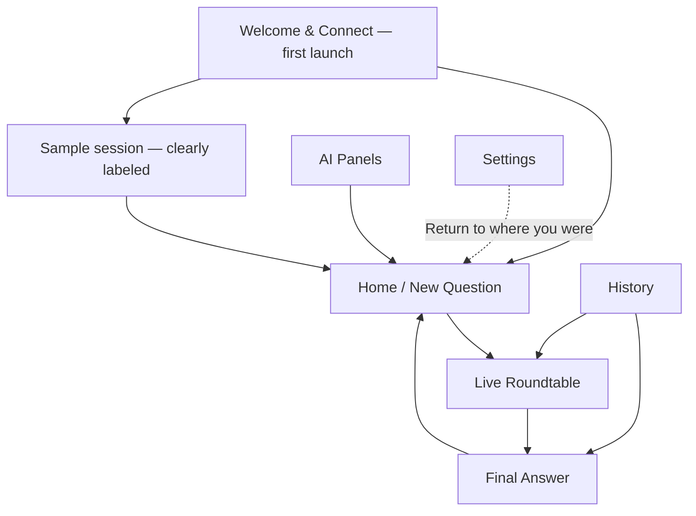

# Roundtable AI — Screens, Navigation and Visual Design Plan

| Field | Decision |
|---|---|
| Product | Personal Windows desktop app |
| Current phase | Screen planning, followed by individual UI designs |
| Approval sequence | Flow and screen list → one screen at a time → connected visual prototype → application development |
| Main screens | **7** |
| Permanent navigation | **4 destinations: Home, History, AI Panels, Settings** |
| Supporting surfaces | **4 reusable panels/sheets**, plus ordinary confirmation dialogs |
| Visual direction | Quiet, precise, Apple-inspired refinement with familiar Windows behavior |
| Delivery later | A Windows installer that can be shared with users; bundled sample for immediate exploration |
| Status | Recommended design plan, awaiting visual review; no screen mockups or app code built in this step |

This plan implements the user's latest direction: a personal app, designed and reviewed before development. The existing [PRD](PRD.md) remains the functional reference. Production dashboards, accounts, team administration and commercial billing do not belong in the interface.

## 1. Experience we are designing

The app should feel like a thoughtful personal research workspace. A user opens it, asks a question, watches several models work, and reads one clear answer with optional access to every review.

The design should impress through proportion, typography, legibility and responsive interactions. The distinctive moment is the live round table: a clear visual explanation of independent answers and reviews. The result should be equally strong when someone wants to read quietly.

Seven means seven full-screen layouts, not seven buttons in the sidebar. Loading, empty, error and populated states are variants of their parent screen. Sheets and inspectors remain in context instead of becoming extra destinations.

## 2. Complete screen list

| ID | Screen | Main job | Primary action | Entry / exit |
|---|---|---|---|---|
| S01 | Welcome & Connect | Explain the idea briefly and connect available model providers | Connect models; then Continue | First launch → Home; sample option → clearly labeled sample session |
| S02 | Home / New Question | Start a question with a selected AI panel | Start roundtable | App startup or Home navigation → Live Session |
| S03 | Live Roundtable | Show private answers, peer reviews, revisions and synthesis | Inspect current work; Cancel remains secondary | Started session → Final Answer; status/error recovery stays here |
| S04 | Final Answer | Read, compare and inspect the completed work | Copy answer; Export secondary | Completed session or History → new question or related paper |
| S05 | History | Find and reopen earlier sessions | Open session | Sidebar → Final Answer or interrupted/live session |
| S06 | AI Panels | Choose the models and their roles once, then reuse them | Save panel / Use panel | Sidebar or Home panel picker → Home with selected panel |
| S07 | Settings | Manage connections, appearance, default limits and local data | Context-specific Save; immediate preferences where safe | Sidebar footer → return to originating screen |

S01 has two steps within the same layout: a short welcome and a connection checklist. S07 reuses that connection component under its Connections section. It does not introduce another screen.

## 3. Navigation and flow

### First launch

Install → Welcome & Connect → select available models → Home.

The connection step includes a recommended panel assembled from available credentials. It does not force the user through the advanced panel editor. A distinct synthesizer role is selected without requiring a fifth provider account.

“Explore a sample” bypasses credentials and opens a bundled session clearly marked Sample. Sample data never appears to be a live answer or a paid run. Connecting models remains available afterward.

### Everyday use

Home → enter question → choose panel → Start roundtable → Live Roundtable → Final Answer.

Reference text and run limits expand inline or open in Run Options. The selected panel, estimated cost and spending ceiling are visible before Start. There is no mandatory confirmation screen after every valid start.

### Permanent app frame

- A restrained left sidebar contains Home, History and AI Panels. Settings sits at the bottom.
- The active session appears as a contextual sidebar item while work is running. It is not another permanent section.
- The main area has a page title and only the actions relevant to that page.
- Windows minimize, maximize and close controls remain in their familiar top-right positions.
- On Live Roundtable and Final Answer, a small session header contains the question title and session status. Their shared session navigation offers Process and Answer; Answer is unavailable with an explanation until it exists.
- History opens a completed session on Answer and an unfinished session on Process.
- Returning from a paper, settings or panel editing restores the question draft, filters and scroll position.
- Navigating elsewhere does not cancel an active session. Its sidebar status remains visible.
- Completion changes the session view to Answer only while the user is watching the live workspace with no open inspector or active text selection. Otherwise show “Answer ready” and let the user open it.
- Back leaves the current view; it never means Cancel. Closing an active app uses the PRD's explicit cancel-and-close behavior.

No top-level tabs competing with the sidebar, no separate analytics landing page, and no nested menus for routine work.

## 4. Screen-by-screen design briefs

### S01 — Welcome & Connect

**Composition:** A quiet introductory area with the product name and a small roundtable illustration; beside it, a focused setup card. The first step offers Connect models and a secondary Explore a sample action. The next step shows provider cards with clear connection status.

**Content:** One sentence explains the product. Each credential field has a provider label, show/hide control while entering, and a clearly labeled test action. A compact note explains that live requests use the user's provider accounts.

**Behavior:** Keep setup progress when moving back. Connected providers remain visible. Continue uses a valid recommended panel; the app explains missing requirements directly beside the action. Connection management is reusable in Settings.

**Required states:** Welcome, connecting, connected, invalid key, no internet, sample entry. No signup, email collection or onboarding carousel.

### S02 — Home / New Question

**Composition:** Persistent sidebar; spacious central question composer; panel selector directly below; restrained reference-text and run-options controls; a short recent-sessions list lower down.

**Content:** Suggested heading: “What would you like to explore?” The composer has a visible question label. The panel shows model names and a small indication of the synthesis role. Start stays next to the cost/limit summary.

**Behavior:** Example questions fill the composer without starting a paid run. The last panel is remembered. Reference text expands when requested. A question draft survives navigation. Starting switches directly to the live workspace.

**Required states:** First use, returning user, draft with reference text, missing connections, invalid panel, one active session already running. In the last state, keep draft editing available and offer Return to active session.

### S03 — Live Roundtable

**Composition:** This is the signature screen. A four-stage strip sits above an elegant circular workspace: the question in the center, one restrained card per model around it, and a thin activity area below. A Table/List switch provides an equally capable alternative.

**Content:** Stage labels are Answer, Review, Improve, Finalize. Each model shows an actual state and a readable label. Review coverage says, for example, “8 of 12 reviews complete.” Cost and elapsed time are compact secondary details.

**Behavior:** Selecting a model or paper opens the inspector. Selecting a reviewer/answer pair highlights that relationship. Completion markers arrive from actual or explicitly simulated events. Transitions show where work belongs; they do not suggest agents are sharing one conversation.

**Motion direction:** Gentle highlight for active work, a brief paper arrival, and a short stage transition. No endlessly spinning table. Parallel reviews are not presented as a fabricated sequential process. An optional explanatory sample can show chair rotation, clearly as a teaching mode.

**Required states:** All four stages, queued, retrying, blocked, cancelled, interrupted and answer ready. For eight seats or high display scaling, cards reflow or use List without shrinking text to fit.

### S04 — Final Answer

**Composition:** A comfortable reading column for the final answer; a compact support/uncertainty panel on the right; candidate answers in an optional comparison section beneath or beside it.

**Content:** Show the question, final answer, meaningful unresolved issues and links to supporting papers. Provide Copy answer and Export. A subtle status label distinguishes Complete, Partial if later supported, and Sample.

**Behavior:** Clicking a claim's support opens the relevant paper and highlights the reference. Compare models reveals their improved answers with a stable selection control. Process returns to the completed roundtable without rerunning anything.

**Required states:** Normal result, long answer, unresolved disagreement, copied/exported feedback, no final answer due to interruption. “Ask another question” opens a new draft; it does not silently carry the previous session into model memory.

### S05 — History

**Composition:** Search at the top, a few useful filters, and a tidy text-led session list. Rows show title/question, date, panel, status and cost certainty.

**Behavior:** Click a row to reopen. A small overflow menu contains Export and Delete. Search/filter state persists when returning. An active or interrupted session remains easy to find.

**Required states:** Empty history, populated history, searching, no matches, interrupted session and deletion confirmation. Avoid decorative charts and irrelevant lifetime totals.

### S06 — AI Panels

**Composition:** A compact panel selector/list beside the selected panel's composition. Model seat cards are grouped together; the final writer is visibly separate beneath them.

**Content:** Each card shows model, provider and role, plus a one-line tuning summary (temperature per role, max output length, cost cap). Advanced system prompts and generation settings stay inside the seat editor. Use the plain-language label “Final writer” with optional help explaining synthesis.

**Seat editor (implemented in the prototype):** three collapsible sections, each openable and closable independently. *System prompt* per role (Answer / Review / Improve; Synthesize for the final writer). *Tuning* with a temperature slider set per role, showing the role default (Answer 0.7, Review 0.2, Improve 0.4, Synthesize 0.3). *Seat limits* with max output length in words and a per-seat cost cap in USD. Model version is deliberately not exposed here because seats may run through OpenRouter or Groq where version pinning is not always available; the exact model id lives in the connection setup instead.

**Behavior:** Add/remove seats within the supported range, duplicate a panel, edit a seat, rename and save. A clear Use this panel action returns to Home. Keyboard controls cover any reordering affordance. Existing running sessions retain their frozen configuration.

**Required states:** Default panel, custom panel, unsaved changes, missing model/key, duplicate-model notice and two/eight-seat layouts. Do not cover the screen with sliders or JSON.

### S07 — Settings

**Composition:** One calm settings workspace with sections for Connections, Appearance, Run Defaults and Local Data & About.

**Content:** Connections uses the setup component. Appearance offers System/Light/Dark and reduced motion. Run Defaults contains understandable limits, with advanced details collapsed. Local Data exposes the data location, cleanup and application version.

**Behavior:** Appearance previews immediately and is reversible. Credential changes have explicit save/remove actions. Run-limit edits affect future sessions. A connection issue opened from Home returns the user to the preserved draft.

**Required states:** Healthy configuration, disconnected provider, credential error, settings saved, local-data deletion confirmation. No profile, subscription, organization, permissions administration or team settings.

## 5. Four reusable supporting surfaces

| ID | Surface | Opens from | Contents / behavior |
|---|---|---|---|
| O01 | Run Options sheet | Home | Spending ceiling, output limits, deadline and expected calls; advanced detail collapsed; returns to same draft |
| O02 | Seat Editor panel | AI Panels | Model/provider selection, answer/review/improvement prompts, supported settings; Save/Cancel |
| O03 | Paper Inspector | Live Roundtable or Final Answer | Paper, reviews about it, revision decisions, and an optional “What this AI received” tab; exact records under Advanced |
| O04 | Export sheet | Final Answer or History | Readable answer or complete session; format choices, contents summary and Windows Save As |

The paper inspector is a side panel on a wide window and an expanded in-app view on a narrow window. It retains its back/close action and returns to the originating selection.

Ordinary confirmations for deleting data, discarding unsaved changes or cancelling are shared dialog components, not extra screens. Panel import and extra export formats remain later features where the PRD assigns them P1.

## 6. Visual direction

**Working direction: light-first, warm neutral, precise and quiet.** Design a graphite dark variant after the first light screen establishes the system.

| Element | Direction |
|---|---|
| Canvas | Soft off-white, initial token #F5F5F7 |
| Content surfaces | Mostly opaque white; subtle layering and fine separators |
| Text | Near-black #1D1D1F; readable secondary gray #616169 |
| Primary accent | A restrained blue, initial token #005FCC; primarily for selection, focus and primary action |
| Model identities | Muted blue, teal, violet and amber markers; names and state labels carry meaning too |
| Typography | Segoe UI Variable / Segoe UI for the installed Windows app; one family with a disciplined size/weight hierarchy |
| Layout | Reference design at 1440×900; check 1280×720 and Windows 100–200% scaling |
| Spacing | 4/8-unit rhythm; typically 24–32 between major groups; compact but readable sidebar |
| Shape | Approximately 10–12 corner radius on controls and 16–20 on primary surfaces; consistent within each component class |
| Icons | One clean outline family, consistent stroke and size |
| Reading | 16 px starting answer text; approximately 65–75 characters per line; controls generally 14–15 px |
| Glass/translucency | Optional and restrained in the navigation/chrome only; opaque reading surfaces |
| Motion | 120–180 ms feedback; 180–280 ms panels; up to 350 ms stage transitions; interruptible and reduced-motion aware |

Colors and dimensions are initial design tokens, not approved final values. Each screen must validate contrast, focus, overflow and text scaling. Do not shrink ordinary content to preserve a decorative layout.

Apple's materials guidance is a reference for depth and legibility, not a requirement to reproduce its platform effects. Keep Windows window controls and keyboard conventions. Microsoft recommends Segoe UI Variable for Windows UI. See [Apple materials](https://developer.apple.com/design/human-interface-guidelines/materials), [Windows typography](https://learn.microsoft.com/en-us/windows/apps/design/signature-experiences/typography) and [Windows title bars](https://learn.microsoft.com/en-us/windows/apps/design/basics/titlebar-design).

The UI/UX skill informed the navigation, progressive disclosure, focus behavior, readable content widths and restrained motion. Its automatic visual matches leaned toward marketing pages, so those layouts and font pairings were not adopted. This is a desktop workspace, with its own deliberately chosen palette and typography.

## 7. Interaction rules

- One visually dominant action per task state.
- Every button has clear hover, pressed, focus and disabled states. Hover never provides the only way to discover or use a feature.
- Primary actions remain reachable while long content scrolls.
- Numbers and timers keep stable widths. New messages do not jump the reading position.
- Progress displays completed work and actual state, never an invented countdown.
- Escape closes the current non-destructive overlay; it never cancels a paid session without an explicit action.
- Ctrl+N opens a new draft; Ctrl+Enter starts only from a ready composer with cost and limit visible; Ctrl+F searches the current appropriate surface.
- Toasts are brief and non-blocking. Persistent failures remain visible with a recovery action.
- Advanced controls are discoverable without occupying the first-use flow.
- Each screenshot uses coherent sample content from one example task, so the demonstration tells a continuous story.

## 8. Personal installation and handoff

The later deliverable is a Windows installer, not source files that users must compile. Runtime prerequisites should be handled through the installation path; there should be no terminal, Node/Python setup, database installation or app account.

A sample session and recommended panel templates ship with the app. Users can install, open and explore the sample immediately. Live LLM calls still require internet access and valid provider credentials entered once on that computer. We must not silently embed personal API keys in the executable or assume Windows Credential Manager entries transfer between PCs.

App installation and moving personal session history are separate operations. If transferring selected sessions is desired later, use an explicit data export/import feature. Private keys and unrelated history do not accompany the installer.

For this personal version, commercial analytics, team features, cloud operations and a public-update service are deferred. Functional reliability, readable error states and safe credential handling still matter.

## 9. Design and approval order

Design one screen at a time in this order:

1. **S02 Home + shared app frame.** Establish typography, color, navigation, controls and spacing.
2. **S03 Live Roundtable.** Establish the signature interaction and stage transitions.
3. **S04 Final Answer + O03 inspector.** Establish reading quality and traceability.
4. **S06 AI Panels + O02 editor.** Establish model setup and advanced controls.
5. **S05 History + O04 export.** Establish finding and sharing results.
6. **S07 Settings.** Reuse form and preference patterns.
7. **S01 Welcome & Connect.** Introduce the experience using the approved visual language.

O01 Run Options is designed with Home. Essential empty, error, loading and narrow-window variants accompany the relevant screen; they do not add permanent pages.

For each screen:
- Present a high-fidelity frame using consistent sample data.
- Show its primary interaction and important states.
- Refine against feedback and explicitly mark its status Draft, Changes requested or Approved.
- Carry approved shared components forward instead of redesigning the app on each screen.

After the individual screens are approved, connect them in a visual-only click-through using sample data. A preview implementation, if used, is a disposable design prototype with no live APIs, credentials, paid calls or production persistence. It must be explicitly labeled as such.

The review should be able to walk through: open sample → Home → start a sample session → inspect one review → read the final answer → export → reopen from History.

**Application development begins after the connected screen flow is approved.** Approval of this plan alone is not approval of the screen designs.

## 10. Completion criteria for the design phase

- Seven screen layouts and four supporting surfaces are accounted for.
- Navigation works both on the happy path and after failure/cancellation.
- Home, Live Roundtable and Final Answer form a convincing continuous demonstration.
- No screen depends on hidden gestures or technical knowledge.
- The design remains legible in the smaller supported window, with large text and reduced motion.
- The sample session is distinguishable from live work at every stage.
- The owner has reviewed the connected prototype and its design status is recorded.

**Next design task: S02 — Home / New Question, including the shared sidebar and window frame.**
